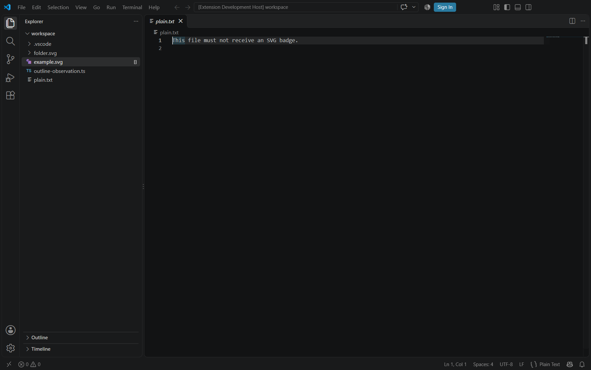
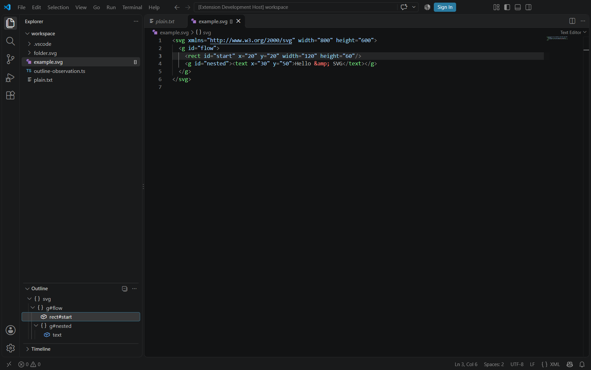
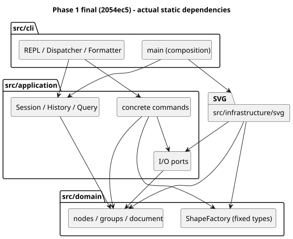
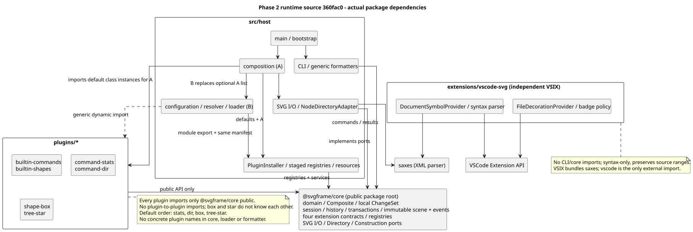

# Phase 2 正式实验报告

日期：2026-11-17。需求依据：[phase_cli_2.md](../docs/phase_cli_2.md)。本报告对应已验收的运行源码 `360fac0c68711a954d27213989fb735eeaec5adc`；第一阶段基线为 `final` → `2054ec5667ad2e5f16b9b52ddd75a3435ed63c9d`。最终报告提交及 p2 应保持相同生产源码，发布后通过交付核对工具重新验证，不能用中间指标冒充未经核验的最终标签。

本轮在已提交源码的干净导出副本中完成依赖安装、全量构建、399项主测试、8项扩展单测、四插件独立测试、开发版/安装版真实宿主及原始字节回放。此为本地验收报告；远端发布状态以 [交付流程](../docs/phase2/RELEASE.md) 和实际 Git refs 核对结果为准。

## 运行与交付物

```powershell
npm.cmd ci
npm.cmd run build:all
npm.cmd run check:tests
npm.cmd test -- --maxWorkers=4
npm.cmd run test:extension:unit
node dist/host/main.js
node dist/host/main.js --config plugins.config.json
```

Node 24.14.0 / npm 11.9.0 / TypeScript 7.0.2 / Vitest 5.0.5；不需要额外数据库或服务。默认代码装配和根配置均按 stats、dir、box、tree-star 顺序提供可选贡献。显式配置替换可选列表，内置十九命令和六图形始终安装；`--config test/fixtures/entries/no-optional.json` 禁用全部可选插件，`--config doc/transcript/inputs/box.plugins.json` 保留 box 而不加星号。

VSCode扩展版本0.2.0，真实宿主1.143.1 / Node24.21.0 / Electron43.7.7；`npm.cmd run package:extension` 重建VSIX。本轮干净构建的包保存于 `.tmp/phase2/p2-6-svg-cli-companion-0.2.0.vsix`，归档6文件，构建/打包/独立安装的bundle完全相同，无node_modules依赖。哈希见 [VSIX证据](evidence/phase2/p2-6-vsix.json)。

## 第一部分：VSCode实践

Explorer 给SVG文件追加 `[]`，目录/普通文件无标记；首次尚未打开SVG时即生效。原生Outline显示根/容器/叶子及原始ID，点击定位到源码，未保存编辑更新，不完整XML清空、补全恢复。扩展不改文件名/内容，不补ID，不施加CLI受限图形语义。

宿主调用Extension.activate，再通过已注册FileDecorationProvider和DocumentSymbolProvider回调获取元数据；SvgOutlineParser独立生成带UTF-16范围的语法树，SvgDocumentSymbolProvider将其适配为DocumentSymbol及Position/Range。生命周期统一释放注册和监听。FileDecorationProvider是装饰元数据管线，并非包装文件对象的经典同接口Decorator；DocumentSymbolProvider是语法DTO到宿主符号协议的Adapter。完整A.3职责/模式/复用分析见 [VSCode实践说明](VSCODE_EXTENSION.md)。复用saxes和显式栈遍历思路，不复用会补ID/领域校验的SvgReader或CLI历史。

以下均为本轮从新VSIX独立安装后捕获的真实界面，已核对可见标记、大纲选择和恢复内容：





[未保存更新](evidence/phase2/p2-6-svg-outline-updated.png)、[不完整XML](evidence/phase2/p2-6-svg-outline-incomplete.png)、[补全恢复](evidence/phase2/p2-6-svg-outline-recovered.png)、[安装版操作证据](evidence/phase2/p2-6-installed-outline-checks.json)和[宿主环境](evidence/phase2/p2-6-installed-host.json)补充异常、取消、版本变化、XML语言模式、大写路径、CRLF/emoji范围验证。操作仅针对临时fixture，扩展不写用户文件。SVG需以Text Editor打开，专用工作区明确编辑关联，不改用户全局设置。

## 第二部分：架构演进与依赖

Phase 1：具体命令位于application，ShapeFactory枚举六类型，main直接装配固定能力。Phase 2：内核持有扩展契约/窄服务，具体命令和形状迁入独立包，host拥有装配/加载/IO；可选插件只依赖core公开包根。保留Composite、Command、Iterator、ID/父归属不变量和局部ChangeSet，没有以全量文档复制实现undo。





PlantUML源码：[final.puml](architecture/final.puml)、[phase2.puml](architecture/phase2.puml)；均已实际渲染，最终图含所有已交付插件及独立VSIX。P2-2c历史框架图保留，不拿缺少真实插件的旧图替代最终图。

| 包/模块 | 实际职责与关键调用 |
|---|---|
| src/core | 领域Component/Composite、应用会话/历史/事务、只读场景/事件、四扩展契约及IO/目录/构建端口 |
| plugins/builtin-shapes、builtin-commands | 六类provider、十九命令Definition/Command、语法与help；通过注册提供默认能力 |
| src/host/composition.ts | 默认内置安装、A的可选对象列表、注入同会话events/history、目录/文件适配器 |
| src/host/loading | B配置/模块归属/解析、共同PluginInstaller、暂存注册与资源、清单校验和回滚 |
| src/host/cli、svg、filesystem | 通用REPL/结果格式化、XML/原子文件替换、NodeDirectoryAdapter |
| 四个可选插件 | 独立package/exports/manifest/测试；不导入host/internal或其他插件，不改已有实现 |
| extensions/vscode-svg | 独立CommonJS bundle与语法视图，不依赖CLI模型 |

## 扩展点与模式的真实落点

| 扩展点 | 内核接口与调用 | 正式类实现及缺省 |
|---|---|---|
| ShapeProvider | Contracts.ts；ShapeFactory.create/restore/help/creationFeedback；CreateCommand、SvgReader消费服务 | 六个内置provider和BoxShapeProvider；未知类型创建报错，未知g标记静默降级；已安装复合损坏不降级 |
| Command | Command/ReversibleCommand、CommandDefinition；CommandDispatcher.parse、CommandExecutor.execute、CommandHistory | 内置命令、StatsCommand、DirCommand及各Definition；缺可选命令unknown command，query不建历史 |
| AttributeHandler | Contracts.ts；AttributeService.resolve → EditTransaction → NodeEditCommand/SetAttributeCommand | BoxFillHandler、BoxLabelHandler；零匹配原属性规则，多匹配修改前拒绝；失败不回退，逆序恢复 |
| TreeDecorator | Contracts.ts；SceneQuery.tree/suffixes → NodeFormatter.tree | BoxTypeDecorator、ModifiedStarDecorator；空表无额外空白，两标签按注册顺序组合，根有上下文 |

详细接口、函数路径、缺省与错误见 [扩展点清单](EXTENSION_POINTS.md)。core不按具体业务名分派；loader没有具体插件导入/映射，formatter只消费通用几何、lines/反馈/后缀。结构和属性策略是纯检查/同步事务契约，不提供恶意插件进程隔离。

Command把请求/局部可逆记录与Receiver分开，Iterator通过文档Iterable按DFS稳定遍历，Composite统一处理整体移动/缩放/迁移。树后缀采用独立装饰管线，与经典对象包装Decorator的结构差异如实记录；没有为满足模式名称引入多余包装。

## 插件行为与关键取舍

stats按DFS首次类型顺序统计叶子及容器，排除根，空g仍计容器，不修改场景/历史。dir依公开DirectoryPort：Target是DirectoryPort，Adapter是NodeDirectoryAdapter，Adaptee是Node readdirSync/Dirent；Adapter输出冻结name/kind和startup path，DirCommand过滤点项、分组/排序/格式化。目录/文件/链接/其他依次输出，各组JS字符串序，标记后两空格，隐藏项保留，不递归/跟随链接/改变cwd；空目录和失败均有固定反馈。替身与真实目录/链接测试覆盖读失败后继续和read/save不改cwd。

box通过ShapeConstructionPort请求基础rect/text，SubtreeBuilder一次构建完整离线模板；语义box、显示g、XML g+data-kind分开。必要直接孩子派生ID为 `<id>-rect`/`<id>-label`，默认填充#4a90d9，文本固定x+20/y+35，允许零尺寸/空标题/额外孩子/嵌套。整体操作允许，必要部件删除/移出/group收编拒绝，同父调序及普通部件编辑允许。fill只传播到本矩形，label只改本文本，一条set一个undo单元，redo重放记录；无处理器则按普通g规则。完整读回先验证候选，损坏拒绝；没有provider才静默降级g，重复ID在降级前拒绝。

modified-star以最近成功save/read/init内容为基线，新节点立即标星，undo或普通编辑回原内容消星，redo重算；比较几何/显式属性/文本/语义/父归属/孩子与根序列/画布，忽略路径和对象身份。变化传播当前祖先，旧父的孩子序列反映删除/移出；画布只标根。失败保存/查询/dir不改变基线。基线和缓存封装在每次激活的装饰器实例，事件订阅暂存并在失败/退出释放。box先于star注册，结果如 `g#p (box) *`，两包互不调用。

正式决策：[ADR001 属性事务](adr/001-attribute-transactions.md)、[ADR002 复合恢复](adr/002-composite-restore.md)、[ADR003 dirty及标签](adr/003-lifecycle-and-labels.md)、[ADR004 安装回滚](adr/004-plugin-installation.md)、[ADR005 公共API与宿主](adr/005-public-api-and-host.md)。每条含实际方法、约束、替代方案与验证位置。

## 双装配、错误与失败原子性

A提供类/实例对象列表，B的`--config`提供模块字符串/可选options/enabled；B替换A可选列表，内置仍安装。相对模块以配置目录为基准，支持包名/目录/明确JS入口与exports；disabled完全不求值。两路共用清单和安装事务：暂存四贡献/休眠订阅 → 同步activate → 方法/重名/贡献集合校验 → 绑定资源并提交；失败逆序恢复当前插件，保留前者并继续后者。配置先整体校验，非法仅用内置启动。

`PluginLoader.test.ts`验证模块找不到、无default、清单不符、激活抛错、内部依赖/求值失败及继续启动；`PluginInstaller.test.ts`验证四贡献、重复锁存、订阅绑定失败、后类别提交失败和资源释放。attributes/transactions/composites/lifecycle测试验证零/单/多命中、多部件局部抛错、反馈/不变量失败、必要部件保护、失败保留来源及双栈，并实际undo/redo；不只比较计数。完整配置与指定stderr见 [装配说明](PLUGIN_LOADING.md)。

## 本轮验证与需求映射

| 范围 | 本轮实际结果与证据 |
|---|---|
| V-01～04 | 新开发版及独立安装VSIX宿主通过；标记/层级/点击/更新/异常恢复截图与A.3说明齐备 |
| F-01～03、L-01～03 | 依赖扫描、四接口/缺省/错误/加载回滚、未知workspace编译加载均在399项中通过；扩展点/装配表已复核 |
| A-01～02、S-01～03 | 框架与真实box测试通过，box单包27项、真实集成15项，版本B与实际SVG往返/损坏/降级覆盖 |
| C-01～04 | stats11项、dir9项独立测试及真实IO/无副作用集成通过；命令与真实根配置回放一致 |
| T-01～02 | star22项独立状态机、12项真实集成、双标签/失败IO/资源释放通过 |
| G-01 | stats/dir/box两证明重新核验，tree-star实际360fac0提交40路径显式审计通过，core/已有插件/loader不变 |
| Q-01～02 | 399主测试+8扩展单测；四包独立入口；五ADR、最终PlantUML、真实Git指标/截图齐备 |
| Q-03 | 五个功能过程节点均已提交；收尾报告/远端master、证明分支和final/p2为最终审阅后的发布流程 |

完整日志索引：[干净环境检查](evidence/phase2/p2-6-clean-checks.json)。原始比较分两层：禁用可选插件的三份会话与final逐字节一致；最终四插件A/B的六份会话逐字节一致，覆盖旧会话、box、stats/dir和双标签，输出流不剥提示符/trim/统一换行。手工预期的语义检查另层执行，不冒充原始字节比较。

```powershell
# 启用插件后的全集合A/B；可指定干净构建目录
node scripts/verify-phase2-release.mjs
# final兼容性需显式禁用可选插件
$env:SVG_CLI_ENTRY='test/fixtures/entries/no-optional.mjs'
npm.cmd run verify:baseline
```

最终双标签会话使用 [cli-2-star-release.txt](transcript/cli-2-star-release.txt)，保存目标在被列目录外，工具同时捕获目录内/外生成物；A/B在同一逻辑cwd依次重置初始文件，日志在cwd外。证据：[六会话全集合](evidence/phase2/p2-6-release-assemblies.json)、[final基线](evidence/phase2/p2-6-baseline.json)、[box浏览器预览](evidence/phase2/p2-6-box-preview.png)及[实际SVG](evidence/phase2/p2-6-flowchart-box.svg)。预览来自本轮CLI生成物的真实Chrome渲染，非重绘示意图。

## 实际提交、指标与可复现性

| 节点 | 实际提交 |
|---|---|
| VSCode实践完成 | c093c7f8a454ec8dd4d16f14152d209ca4a87ed4 |
| 框架冻结 | 1ff4352de83ac64943f36c9d51684101249fa1f6 |
| stats / dir完成 | 92cde9f057f3b46080b8750f20555ef94c7f83dd / 8dc8e39174e1953550f46de3a34c3ac0e5c0e291 |
| box共同父F | f5236b500194d129345479799d149e22d18acb52 |
| box C_A（仅composition） | f20745a82f12765a95b415b12893f8605cb52a4d |
| box C_B（仅配置） | 9a8aeb65f21f14abd807c4e1c2f27dad40d0519a |
| box整合 | 1d1b64628860d619e24b561bc49b2eeb435c29cc |
| 标签完成/运行源码终态 | 360fac0c68711a954d27213989fb735eeaec5adc |

box两证明唯一父提交均为F，完整插件包相同，各24路径零违反，独立工作区各365项测试通过；最终报告提交不能替代它们。tree-star同时集成两个入口，按其真实提交逐项审核两入口、依赖、测试/文档，未使用仅容许单入口的工具伪报通过。证据：[stats](evidence/phase2/p2-6-stats-diff.json)、[dir](evidence/phase2/p2-6-dir-diff.json)、[box A](evidence/phase2/p2-6-box-code-diff.json)、[box B](evidence/phase2/p2-6-box-config-diff.json)、[star实际提交](evidence/phase2/p2-5-committed-diff.json)。

指标由冻结工具读取真实Git blobs：[final→源码终态](../docs/metrics/phase2-source.md) / [JSON](../docs/metrics/phase2-source.json)、[star接入增量](../docs/metrics/tree-star-integration.md)。下表摘录生成结果，原始指标未手工修改：

| 分类 | 文件数 final→Phase2 | 代码行 final→Phase2 | 函数复杂度 final→Phase2 |
|---|---|---|---|
| core | 45→35 | 1340→1321 | 445→475 |
| host/装配 | 11→20 | 596→804 | 238→371 |
| plugins | 0→55 | 0→968 | 0→312 |
| CLI总量 | 56→110 | 1936→3093 | 683→1158 |
| VSCode（单列） | 0→6 | 0→143 | 0→49 |

core行数变化包含内置实现迁移，不能当功能删除；CLI净增1157代码行、函数复杂度增475。物理行、文件职责、逐函数数据和明确AST口径见JSON；排除测试/依赖/构建产物/脚本，VSCode不混入CLI。star增3生产文件/59代码行/25函数复杂度，core增量0，host仅2行装配。这里没有声称整体复杂度下降；新增通用协议与失败原子性是有成本的扩展能力。

```powershell
npm.cmd run metrics -- final 360fac0 --output docs/metrics/phase2-source
node scripts/verify-phase2-delivery.mjs --revision HEAD --metrics
# p2发布后：核对生产源码相同、final未移动、最终指标与远端必需引用
node scripts/verify-phase2-delivery.mjs --revision p2 --metrics --remote
```

源码与包元数据指纹见 [运行源码记录](evidence/phase2/p2-6-runtime-source.json)。最终报告提交可增加文档、图、证据和验收工具，生产目录/包/构建配置须与360fac0完全相同；交付工具重算final/p2并比较全部文件指标及分类增量，避免因报告提交SHA不同导致指标不可追溯。

## AI建议核查与范围

| 建议/初始假设 | 核验、修正及实际结果 |
|---|---|
| 旧规范化测试可当兼容证明 | Buffer级独立回放保留提示符/换行；三份final和六份全集合A/B通过 |
| dirty可用编辑次数/历史位置 | 同值设置、undo回保存点、canvas清历史仍变脏证明不成立；改为实例内容比较，22+12项验证 |
| box可在命令里按名字保护 | 删除/迁移/group绕过风险由通用结构策略统一处理；真实box接入不改core/formatter |
| Node ESM可直接导入插件目录 | 通用resolver显式读取exports/main并校验manifest归属；路径/目录/内部依赖失败回归通过 |
| 更新API成功等同大纲UI恢复 | 同时等待真实Outline标签恢复并捕获新截图，不把数据恢复代替视图恢复 |
| 在Git archive目录直接运行历史导出器 | 初次因git ls-tree相对前缀失败；未改工具，在真实仓库运行并明确指向干净编译CLI，三份字节通过 |
| 原star会话保存到cwd也不会影响先前dir | 最终会话将保存移到cwd外，新增捕获目录内/外产物的验收工具，严格满足目录约定 |
| 中间源码指标自动代表最终p2 | 固定360fac0、保留源码指纹，p2后重算比对；发布前不声称远端已完成 |

不包含选做图形、市场发布、热插拔或恶意插件沙箱。CLI仍遵循课程受限SVG规范，VSCode大纲只做语法视图。最终发布是明确的Git交付步骤；本报告的测试、截图或本地分支不替代远端final/p2和证明分支可达性。
