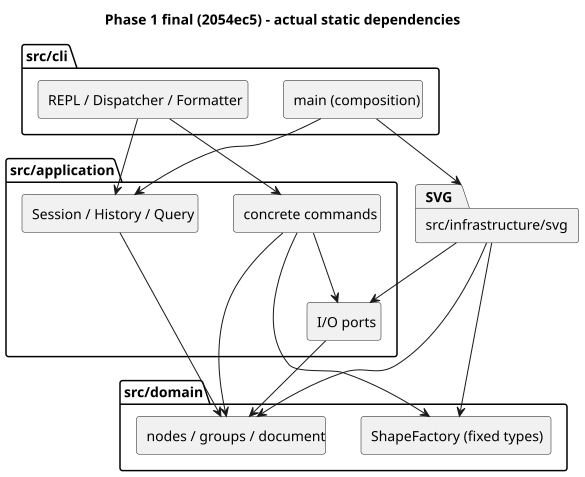
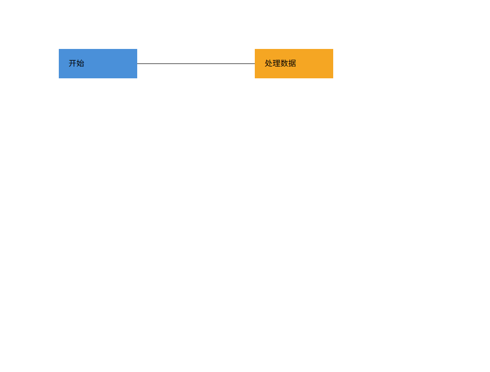
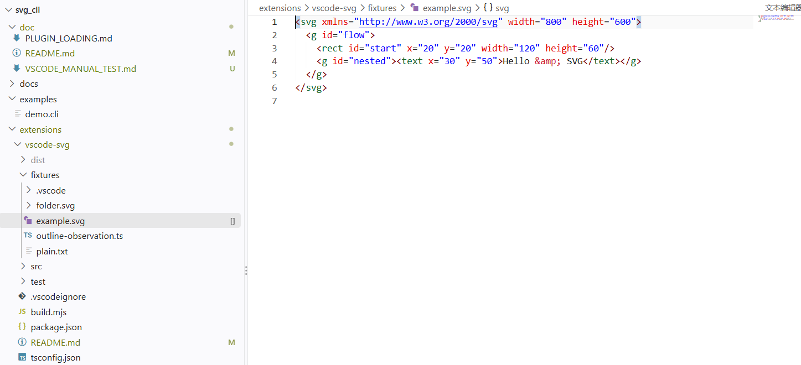
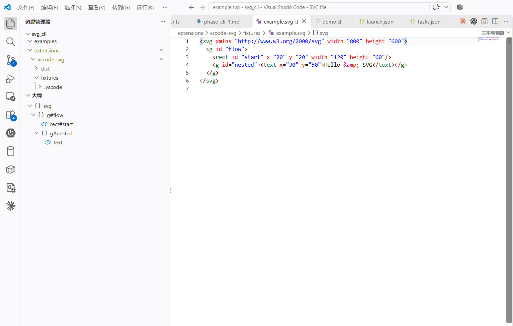
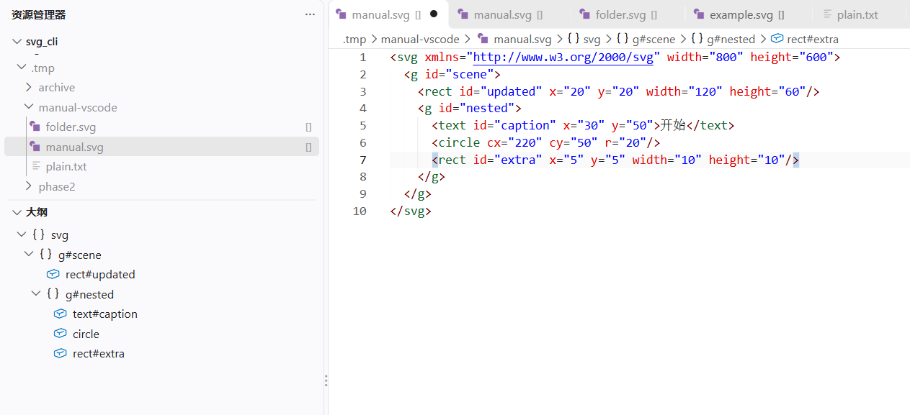
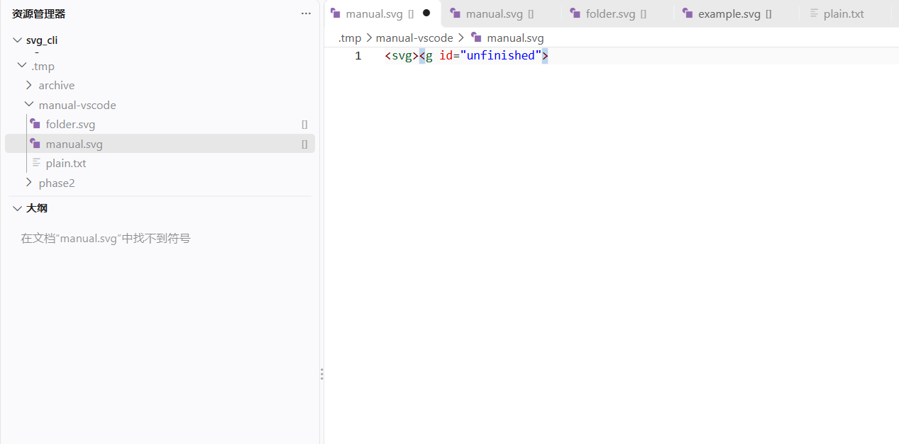

# SVG CLI 项目报告

本文整理SVG编辑器的扩展点、插件装配、架构重构、设计决策及AI协作检查。操作说明见 [用户指南](../README.md)，需求依据为 [第一阶段](../docs/phase_cli_1.md) 和 [第二阶段](../docs/phase_cli_2.md) 需求。

整理日期：2026-11-18；验收截图与验证记录更新日期：2026-11-23。本文已补齐环境、插件与加载器测试、兼容性回放、VSIX独立安装及指标记录。第8.4节保留作者提供的六张VSCode人工截图，自动补验结果另行注明，不推定截图中的宿主版本或安装方式。阶段计划、重复过程报告、旧日志和截图已归入本地 `.tmp/`，本轮原始日志同样仅在本地保留。

## 1. 项目目标与结构

第一阶段实现内置图形、Composite分组、Command撤销重做、文档遍历和SVG读写。第二阶段在保留这些能力的基础上，建立四个稳定扩展点、独立插件包、代码/配置双装配，并实现独立VSCode扩展。

```text
src/core/                 领域模型、应用服务、公开扩展契约与端口
src/host/                 CLI、装配、插件加载、XML和文件系统适配
plugins/builtin-*/        内置图形和命令
plugins/command-stats/    图形统计
plugins/command-dir/      启动目录列表
plugins/shape-box/        复合box、属性处理器、类型标签
plugins/tree-star/        内容差异星号
extensions/vscode-svg/   SVG文件标记与原生Outline
test/                    核心、宿主、加载器和集成测试
doc/transcript/          可复用会话、预期和回放fixture
doc/adr/                 设计决策记录
doc/architecture/        架构图源码与最终渲染
doc/images/              本轮报告截图
docs/metrics/            脚本生成的历史源码指标
.tmp/                    本地过程归档、原始日志，不提交
```

领域层不依赖宿主、Node或具体插件；插件只导入 `@svgframe/core` 的公开包根。宿主负责实例装配、模块解析和外部IO，VSCode包不依赖CLI领域模型。

## 2. 重构前后的架构

### 2.1 重构前

具体命令在应用层，ShapeFactory识别固定类型，入口直接装配已知能力。新增命令、形状或显示行为容易涉及既有工厂、分发和输出逻辑。



图源码：[final.puml](architecture/final.puml)。

### 2.2 重构后

core持有模型、协议和通用服务，内置实现同样通过注册提供。host选择代码对象列表或配置模块列表，两者共用安装事务。输出使用通用结果、几何描述和后缀，核心与渲染器无需按具体插件名分派。


图源码：[phase2.puml](architecture/phase2.puml)。

| 方面 | 重构前 | 重构后 |
|---|---|---|
| 图形创建 | 固定工厂识别类型 | ShapeFactory查询ShapeProvider |
| 命令分发 | 既有具体命令 | CommandDefinition提供语法/help/build，分发器查注册表 |
| 属性编辑 | 节点原有规则 | AttributeHandler可接管，缺省仍走原白名单 |
| 树显示 | 固定基础格式 | TreeDecorator追加后缀，通用formatter组合 |
| 具体实现 | 领域/应用目录内 | builtin-shapes、builtin-commands及独立可选包 |
| 加载 | 固定入口装配 | A代码对象或B配置模块，共同校验与回滚 |
| IO依赖 | 应用拥有文件端口 | 保留端口，并补Directory/Construction端口 |
| 包边界 | 单CLI工程 | core、插件、host与独立VSIX，通过public exports使用 |

Composite、Command、Iterator和局部ChangeSet继续使用；不是重新实现一套领域模型。容器仍支持整体操作，成功编辑保存可逆记录，查询通过只读快照投影。

## 3. 四个扩展点

接口主要位于 `src/core/extensions/Contracts.ts` 和 `src/core/application/commands/Command.ts`。四类注册表独立管理稳定名称和注册顺序，插件获得窄注册接口与受控服务。

| 扩展点 | 职责 | 调用位置 | 正式类实现 | 缺省/失败 |
|---|---|---|---|---|
| ShapeProvider | 离线创建、完整恢复、help及反馈 | ShapeFactory.create/restore/help，CreateCommand与SvgReader消费服务 | 六内置provider、BoxShapeProvider | 未知创建类型报错，未知g标记降级；已安装但损坏拒绝 |
| Command / CommandDefinition | 命令语法、构建、执行和可逆协议 | CommandDispatcher.parse、CommandExecutor.execute、CommandHistory | 内置命令、Stats/Dir的Definition与Command | 缺可选命令报unknown；query不建历史 |
| AttributeHandler | 纯匹配，经AttributeEdits修改部件 | AttributeService.resolve、EditTransaction、SetAttributeCommand | BoxFillHandler、BoxLabelHandler | 零匹配原规则，多匹配先拒绝；失败不回退 |
| TreeDecorator | 读取冻结行上下文，返回可选后缀 | SceneQuery.tree/suffixes、NodeFormatter.tree | BoxTypeDecorator、ModifiedStarDecorator | 空表保持原格式；异常使本次查询失败 |

详细方法、文件路径和错误见 [扩展点参考](EXTENSION_POINTS.md)。public出口不暴露内部树操作符号，插件不导入host、core内部文件或其他具体插件。

### 3.1 属性事务

`handles`只读匹配。单命中时，处理器只获得目标冻结视图和 `AttributeEdits.read/setAttribute`，没有任意可写文档、commit/rollback或外部回调步骤。每个已完成原子变更即时记录；处理器、反馈生成或不变量校验失败时逆序恢复。

一次set仅进入一个历史单元，redo重放既有记录与反馈，不重跑处理器。无匹配保留原节点能力；失败不能悄悄重试默认路径。验证时需比较文档、来源、双栈，并实际undo/redo确认栈中对象可用。

### 3.2 box与完整恢复

BoxShape继承公开SvgGroup，领域语义为box、树基础标题为g、XML为g加data-kind。provider通过ShapeConstructionPort请求rect/text，再由SubtreeBuilder一次组装完整离线子树，不跨插件导入基础实现。

必要直接孩子ID为 `<id>-rect`、`<id>-label`。删除、移出或group收编必要部件拒绝，同父调序和普通编辑允许；整个box可以移动、缩放、迁移、分组或删除。fill只修改本box矩形，label只修改本文本，不向嵌套box递归传播。

读取先验证完整候选子树，再替换会话。provider已注册但结构损坏直接拒绝；未安装provider时未知g标记静默降为普通组，保留合法样式/孩子并移除标记。重复ID在路由前检查，不能因降级被忽略。

### 3.3 内容差异和标签

modified-star按“与最近成功save/read/init内容不一致”判断，而不是编辑次数或历史栈位置。新节点立即标星，undo或普通编辑回原内容消星；失败保存和查询不更新基线。

比较几何、显式属性/文本、类型、父归属、孩子/根顺序及画布。变化传播当前祖先与SVG根；删除/移出由旧父孩子序列体现，单纯画布变化只标根。基线与缓存为每个实例私有字段，成功提交后才接收生命周期通知。

box-type-label先于modified-star注册，输出 `g#id (box) *`。两者互不调用、互不读状态。这里是独立装饰管线，不等同于经典同接口对象包装Decorator。

## 4. 插件装配和加载器

### 4.1 方式A：代码装配

`src/host/composition.ts` 的optionalPlugins返回 `{ module, plugin, options? }` 列表。不带--config时使用它，内置包与可选包都通过PluginInstaller；代码方式也读取同一包清单并校验贡献。

默认顺序为stats、dir、box、tree-star。新增业务通过顶层装配点与必要依赖接入，不应修改core、loader、formatter或已有插件。

### 4.2 方式B：配置装配

```powershell
node dist/host/main.js --config plugins.config.json
```

```json
{
  "plugins": [
    { "module": "@svgframe/command-stats" },
    { "module": "@svgframe/command-dir" },
    { "module": "@svgframe/shape-box" },
    { "module": "@svgframe/tree-star" }
  ]
}
```

显式配置替换A可选列表，内置能力仍安装。条目支持module、enabled、options，相对模块以配置目录为基准，包名遵守该目录Node解析上下文。通用resolver处理包名、目录和明确JS入口；disabled完全不求值，options交给插件判断。

### 4.3 清单校验与失败隔离

package.json的contributes声明shapes、commands、attributes、decorators名称，省略为空。流程为：整体配置校验 → 逐项解析 → 暂存注册/休眠订阅 → 同步activate → 方法/重名/贡献集合检查 → 绑定资源并提交。

当前插件失败时释放其订阅并恢复已提交类别，保留前面成功的插件，继续后续项；重复注册即使被捕获也会使安装失效。退出按逆序释放资源。非法配置只使用内置能力启动，模块缺失/无default/清单不符/激活失败等有固定反馈，见 [装配参考](PLUGIN_LOADING.md)。

loader不含具体插件导入或名称映射。A/B行为一致性与Git接入边界是两种证据：前者比较同集合/顺序/options/cwd下原始输出，后者检查真实接入提交和实际存在的受保护路径，不能仅以工作区空输出证明。

## 5. 目录Adapter与VSCode实践

### 5.1 dir的Adapter角色

Target是公开DirectoryPort，Adapter是NodeDirectoryAdapter，Adaptee是Node readdirSync/Dirent。适配器冻结name/kind和startup path；DirCommand负责点项过滤、分组排序与两空格输出。

目录/文件/链接/其他依次输出，组内使用JS字符串序，隐藏项保留，不递归、不跟随链接、不改变cwd。dir不要求SVG初始化，不改变文档、来源、保存基线或历史；read/save不改变启动目录。

### 5.2 VSCode职责、调用与复用

VSCode负责激活、文件系统、Explorer/Outline展示及导航。扩展注册FileDecorationProvider与DocumentSymbolProvider类实例，宿主按需回调，体现控制反转；ExtensionLifecycle统一管理释放。

文件装饰返回 `[]` 元数据，并未包装文件对象，因此与经典Decorator结构不同。SvgOutlineParser生成保留原始ID和UTF-16范围的语法树，SvgDocumentSymbolProvider将其适配为DocumentSymbol/Position/Range，是较直接的Adapter。

复用saxes和显式栈遍历思路，不直接复用CLI的SvgReader、SvgDocument或历史：大纲应接受无ID、任意合法元素和未保存文本，不补ID或施加课程图形白名单。取消/版本变化时丢弃结果；XML不完整清空，补全后重建。

安装、Text Editor关联、F5和独立宿主方法见 [扩展README](../extensions/vscode-svg/README.md)。实际运行截图与A.3实践观察记录见第8.4节。

## 6. 设计决策

| 决策 | 选择和原因 | 记录 |
|---|---|---|
| 属性失败原子性 | 冻结目标+受控同步事务+局部记录；不接受任意回调冒充原子步骤 | [ADR001](adr/001-attribute-transactions.md) |
| 复合容器与读回 | 通用结构策略、完整后序恢复；仅缺provider的未知g标记降级 | [ADR002](adr/002-composite-restore.md) |
| dirty与标签 | 内容差异、当前祖先传播、box在star前，状态实例私有 | [ADR003](adr/003-lifecycle-and-labels.md) |
| 安装与清单 | A/B共用暂存校验与回滚，禁用不求值 | [ADR004](adr/004-plugin-installation.md) |
| API与宿主边界 | public exports、端口适配、通用构建/解析不枚举新包名 | [ADR005](adr/005-public-api-and-host.md) |

增加注册/事务/加载层会增加代码量和复杂度，换取接入边界，不保证整体更短。策略/处理器要求可信插件遵守同步、纯检查、原子变更契约，不是恶意插件沙箱；不实现热卸载或完整SVG规范。box标题采用固定模板偏移，不声称文字自适应居中。

## 7. AI协作时的检查与修正

以下是开发时检查过的建议，不替代第8节的本轮验证结果。

| AI建议或初始假设 | 核验依据 | 采纳或修正 | 本轮核验证据 |
|---|---|---|---|
| 规范化输出足以证明兼容 | 去提示符/trim/改换行可能隐藏差异 | 增加Buffer级两流和生成物比较 | 第8.3节原始回放 |
| dirty可用编辑次数或历史位置 | 同值、回保存点、canvas历史屏障语义不同 | 内容比较，实例保存基线/缓存 | 第8.1节同值/undo/redo/失败保存 |
| box只需在delete/ungroup按名字保护 | move/group/跨父操作也能破坏部件 | 用通用容器结构策略 | 第8.1节各破坏路径 |
| 先建空组再恢复复合部件 | provider会看见半成品 | 完整离线组装后验证/挂接 | 第8.1节损坏拒绝与原状态保留 |
| Node ESM可直接导入目录 | 目录入口与exports、清单归属有区别 | 通用resolver解析目录/入口/manifest | 第8.2节各路径及依赖失败 |
| 大纲可直接复用SvgReader | CLI补ID/领域校验与语法范围需求冲突 | 仅复用解析库，独立语法DTO和Adapter | 第8.4节无ID/异常恢复 |
| XML列号可直接作编辑器列号 | CRLF/emoji涉及UTF-16偏移 | 用document.positionAt转换偏移 | 第8.4节源码范围与定位 |
| API恢复等同Outline已恢复 | 数据与原生视图刷新有时序差异 | 等待真实可见节点再截图 | 第8.4节恢复截图 |
| 最新类型包一定适合本机 | 类型版本可能高于固定宿主 | 固定兼容依赖并由真实宿主验证 | 第8.4节版本记录 |
| 中间源码指标等同最终标签 | 报告提交与运行源码SHA不同 | 指标明确revision，最后重算并检查源码差异 | 第8.5节最终SHA/命令 |

本轮补充检查记录：

| 日期/建议 | 检查依据 | 采纳/修正 | 实际结果或材料 |
|---|---|---|---|
| 2026-11-23：并发全测一次通过即可作为结果 | 4 worker时Git树工具用例超过默认5秒，398项通过、1项超时 | 保留失败日志，不调整断言或超时；改用1 worker复测 | 43文件、399项全部通过；见第8.3节与日志03/04 |
| 2026-11-23：仓库内相对文档链接可以直接打入VSIX | vsce无法为`../../doc/VSCODE_MANUAL_TEST.md`推导发布地址，打包退出1 | 扩展README改为明确的仓库文件路径；重新打包、独立安装 | 重打包退出0；安装版标记、大纲及释放检查通过，见日志17—19 |
| 2026-11-23：六张人工截图已证明全部运行条件 | 截图没有展示未打开SVG时的激活、文件哈希和安装路径 | 保留原图及可见事实，通过真实宿主补验这些条件 | 两种宿主的badge-checks/outline-checks/host记录及bundle一致性核对，见第8.4节 |

## 8. 测试与验证记录

以下命令与自动补验均于2026-11-23执行。作者提供的人工截图用于说明界面现象；自动测试用于补充状态、字节和安装边界断言。命令、退出码及完整输出索引保存在本地 `.tmp/verification/report-2026-11-23/index.json`，下文“日志NN”对应同目录编号JSON。原始过程材料不提交，报告截图保存在 `doc/images/`。

### 8.0 环境

| 项目 | 实际记录 |
|---|---|
| 日期、操作系统、终端 | 2026-11-23（UTC+8）；Windows 11家庭版中文版，64位，10.0.26200/build 26200；Windows PowerShell 5.1.26100.9818 |
| 分支、完整提交SHA | `master`，`474bedee351f42b2124b0e7730fe44787a25aabb`；本轮文档更新尚未提交，运行源码与该提交一致 |
| Node.js / npm / TypeScript / Vitest | `v24.14.0` / `11.9.0` / `7.0.2` / `5.0.5` |
| VSCode / 扩展版本 | 自动开发宿主和独立安装宿主均为`1.143.1`；SVG CLI Companion `0.2.0`；宿主内Node `24.21.0`、Electron `43.7.7`。作者截图未显示版本，故不据图推定 |
| 安装、构建命令与退出码 | 沿用已有依赖安装，`npm.cmd ls --depth=0`退出0（日志05），本轮未重复`npm ci`；`npm.cmd run build:all`、`npm.cmd run check:tests`均退出0（日志01/02）；VSIX打包复测退出0（日志18） |

全新环境准备命令：`npm.cmd ci`、`npm.cmd run build:all`、`npm.cmd run check:tests`。以下PowerShell命令在仓库根执行，其他平台使用npm。

### 8.1 插件与业务功能

```powershell
npm.cmd test --workspace @svgframe/command-stats
npm.cmd test --workspace @svgframe/command-dir
npm.cmd test --workspace @svgframe/shape-box
npm.cmd test --workspace @svgframe/tree-star
```

| 检查项 | 预期观察 | 实际结果、日志或截图 |
|---|---|---|
| stats | 首次类型顺序、根排除、空容器、查询无副作用 | 独立包11项通过、退出0（日志06）；全量集成验证查询不改变文档和历史 |
| dir | 替身/真实目录、隐藏项/排序/链接、失败继续、read/save不变cwd | 独立包9项通过、退出0（日志07）；真实CLI目录会话与失败继续由全量测试及commands回放覆盖 |
| box | 模板/ID冲突、整体操作、部件保护、fill/label与undo/redo | 独立包27项通过、退出0（日志08）；完整业务集成见`test/integration/box.test.ts`，回放生成保存及读回SVG |
| SVG恢复 | 完整往返、损坏拒绝、未安装降级、重复ID及失败保留来源/redo | 全量399项中的`SvgReader.test.ts`、`box.test.ts`和`box-baseline.test.ts`通过；box回放两种装配的生成文件逐字节相同（日志04/14） |
| 属性事务 | 零/单/多命中，局部失败回滚，一次set一个单元 | 全量应用层与box集成断言通过（日志04），包含失败前后状态、来源、历史及真实undo/redo；不只比较错误文案 |
| modified-star | 新建/保存/再编辑/undo/redo/分叉/失败保存/祖先/画布/多会话 | 独立包22项通过、退出0（日志09）；`test/integration/tree-star.test.ts`的生命周期、失败保存和多会话断言通过（日志04） |
| 双标签 | `(box) *`顺序、独立禁用、根/子树显示 | tree-star集成验证box后接星号、仅star和显式禁用；全集合A/B的labels会话原始两流及文件一致（日志04/14） |

上述独立包测试是全量测试的子集，不能与399相加。插件和Undo/Redo采用可复现会话与状态断言记录，本轮没有另造终端截图；实际生成的box浏览器截图见第8.3节。

### 8.2 加载器与装配

```powershell
npm.cmd test -- --maxWorkers=1 test/loading
npm.cmd test -- --maxWorkers=1 test/architecture
```

| 检查项 | 预期观察 | 实际结果、日志或截图 |
|---|---|---|
| A/B共同路径 | 均经过清单校验/安装事务，集合/顺序/options一致 | 加载器2文件22项、架构1文件6项均通过、退出0（日志10/11）；六组四插件A/B回放一致（日志14） |
| 四类失败 | 缺模块、无default、清单不符、activate抛错后仍可运行 | `PluginLoader.test.ts`逐类断言错误并验证后续插件和交互命令可继续（日志10） |
| 重复/部分失败 | 当前全部回滚、前者保留、后者继续，资源无残留 | `PluginInstaller.test.ts`验证四类注册共同提交、捕获重复仍失败、后类别提交失败恢复、订阅失败释放及退出释放（日志10） |
| 配置与路径 | 非法配置只启内置，disabled不求值，包名/目录/JS按配置目录解析 | 目录入口、明确JS、import-only exports、显式配置覆盖A、禁用项不解析及非法配置回退全部通过（日志10） |
| 内部依赖失败 | 入口存在但内部依赖/求值失败，不误报顶层缺模块 | 加载测试分别断言依赖缺失和模块求值失败，保留与顶层模块缺失的诊断区别（日志10） |
| 接入边界 | 真正存在的core/loader/既有插件路径差异为空，解释装配/元数据 | stats、dir、box A/B真实Git提交审计均0违规；tree-star另核对双入口接入、9组实际存在的受保护路径无变化，见第8.5节 |

失败隔离的证据为加载器真实模块fixture、子进程交互断言及日志10；Git差异审计保存在同一日志目录的 `git-{stats,dir,box-a,box-b,star}.json`，不以终端截图代替回滚和资源断言。

### 8.3 功能兼容性与双装配

```powershell
npm.cmd test -- --maxWorkers=1
$env:SVG_CLI_ENTRY='test/fixtures/entries/no-optional.mjs'
npm.cmd run verify:baseline
Remove-Item Env:SVG_CLI_ENTRY
node scripts/verify-phase2-release.mjs
```

基线工具需要本地正确final标签，会导出该版本并按历史锁安装构建，可能需要网络。A/B必须同实现/集合/顺序/options、初始文件和cwd；比较原始stdout/stderr，不去提示符/trim/改换行。dir会话的日志与保存文件应在被列目录外。

| 检查项 | 实际记录 |
|---|---|
| 全量命令、退出码、文件/测试数量 | `npm.cmd test -- --maxWorkers=1`退出0，43文件、399项通过，Vitest记录25.03秒（日志04）；独立VSCode单元测试8项通过、退出0（日志12） |
| final标签对象与提交SHA | 本地附注标签对象`7d178c98f5038950b8ece6fcc6d204dcaf5a9879`，提交`2054ec5667ad2e5f16b9b52ddd75a3435ed63c9d`；本轮只读核对，未移动标签 |
| 无插件时与final原始两流和SVG对比 | 退出0，`cli-1-basics.txt`、`cli-1-flowchart.txt`、`cli-1.txt`三份会话的stdout/stderr与保存SVG逐字节一致；原始数据和哈希见本地`.tmp/phase2/baseline-vffLrx/result.json`（日志13） |
| 四插件全集合A/B六份会话、输入/输出哈希与生成物 | 退出0，basics/lecture/flowchart/box/commands/labels六组全部一致；每组输入、原始两流和全部文件SHA-256见本地`.tmp/phase2/release-fV1cEA/result.json`（日志14）；两种装配都启用相同顺序的stats/dir/box/tree-star |
| 实际生成SVG的浏览器查看 | Chrome以独立临时配置打开box回放的`flowchart-box.svg`；“开始”和“处理数据”两框、中文文字与连接线正常显示，见图8-0；该SVG的SHA-256为`746e10d9af7eb5c483d98e51dc5a325f40d933c3e9e91f567ef0a33b18cd9b56` |
| 失败、定位、修正和复测 | 初次`--maxWorkers=4`退出1：42文件通过、1文件失败，398项通过、1项Git树工具用例超过默认5000ms（实测5138ms，日志03）。仅改为1 worker复测即全部通过，源码、断言及超时配置未改；并发负载可能影响该用例，尚不能据此确定根因。另有VSIX文档链接打包失败及修复，见第7节与日志17/18 |



*图8-0：本轮A/B回放生成的box流程图在Chrome中的实际渲染。蓝色“开始”框与橙色“处理数据”框之间显示连接线；本例没有绘制箭头头部。该图为自动补验截图，与第8.4节作者提供的人工截图分别记录。*

### 8.4 VSCode扩展与截图

逐项操作请先阅读 [VSCode插件人工测试指南](VSCODE_MANUAL_TEST.md)，其中包含“只能看到[]”的入口排查、完整测试SVG、操作步骤、预期结果及截图清单。

```powershell
npm.cmd run build:extension
npm.cmd run test:extension:unit
npm.cmd run test:extension
npm.cmd run package:extension
```

人工运行可用Install from VSIX安装包，或按F5启动开发宿主；以Text Editor打开SVG，查看原生Outline。本轮自动补验分别运行开发模式和隔离安装模式，固定宿主1.143.1，均退出0（日志16/19）。开发模式材料位于本地`.tmp/phase2/extension-uxwkUj/`；独立安装使用操作系统临时目录，关键JSON已复制到本地日志目录的`installed/`。测试只编辑临时fixture，未改作者的人工测试文件。

独立安装复现命令如下；在没有设置可执行文件覆盖时，测试框架会下载固定宿主。本轮使用已缓存的同版本`Code.exe`，通过`SVG_VSCODE_EXECUTABLE`指定。

```powershell
$env:SVG_TEST_VSIX='.tmp/phase2/svg-cli-companion-0.2.0.vsix'
npm.cmd run test:extension
Remove-Item Env:SVG_TEST_VSIX
```

| 场景 | 操作与预期 | 实际观察、版本及材料 |
|---|---|---|
| 文件标记 | 未打开SVG即见`[]`，普通文件/目录无标记，原文件不变 | 图8-1中example.svg显示`[]`，plain.txt和folder.svg目录无该标记；两种自动宿主均记录`noSvgOpened: true`、自动激活成功及fixture前后名称/哈希一致，创建/修改/重命名/删除刷新、取消和释放通过 |
| 原生大纲 | 根/容器/叶子/无ID层级正确 | 图8-2显示svg、g#flow、rect#start、g#nested及无ID的text节点 |
| 点击定位 | Outline点击节点，编辑器定位对应源码范围 | 图8-3中大纲选中rect#start，源码同时定位到第3行的rect起始标签 |
| 未保存更新 | 修改ID/层级，视图无需先保存就更新 | 图8-4中编辑器仍有未保存圆点，大纲已显示rect#updated与新增rect#extra |
| XML异常恢复 | 不完整时清空，补全后真实视图出现正确节点 | 图8-5中不完整XML使大纲显示找不到符号；图8-6中完整XML与对应节点树重新出现 |
| 独立安装 | 版本/路径正确，不依赖仓库node_modules | VSIX 0.2.0安装至仓库外的独立临时扩展目录，未携带node_modules；真实窗口标记、大纲、点击第3行、未保存更新、异常恢复、取消、过期版本丢弃、UTF-16范围及释放均通过（日志19）。安装模式仅用空驱动启用测试，不把SVG源码目录作为开发扩展加载 |
| A.3实践 | 宿主回调、Decorator/Adapter角色及与CLI复用差异 | `activate`注册两个provider，VSCode按需调用装饰与符号接口；图8-1体现元数据装饰，图8-2—6体现语法树→DocumentSymbol的Adapter及宿主展示/导航。CLI的领域读回会补ID和施加领域约束，因此只复用saxes与显式栈遍历思路，不复用会话/历史；无ID和未保存文本由真实宿主测试覆盖，详见第5.2节 |

打包复测生成6个ZIP条目，19519字节；VSIX SHA-256为`0235e14f292da5c704bcb9a37a7fb65ed3a28655c20684ec4bfdfac68cf6cdd3`。开发构建、包内及已安装的`extension.cjs`逐字节相同，bundle SHA-256为`baf51b25bfcb0a6f46f740940de90d6f6d5b3996d808ddeda3f62e4c0d8808c3`；清单、等值检查及node_modules排除记录见本地`bundle-verification.json`。这些记录证明本轮自动测试产物，不用于反推作者截图的安装来源。

#### 文件标记



*图8-1：Explorer中example.svg右侧显示`[]`，plain.txt和folder.svg目录没有该标记。编辑器中的文件名仍为example.svg。此图展示文件类型区分；自动激活和文件内容不变由本节另述的真实宿主操作记录佐证。*

#### 原生大纲层级



*图8-2：以文本编辑器打开example.svg后，原生大纲展示svg根、g#flow、rect#start和嵌套的g#nested；没有ID的文本元素仅显示为text。层级与右侧XML结构对应。*

#### 点击定位源码


*图8-3：manual.svg的大纲选中rect#start时，编辑器定位到第3行的rect起始标签；同时保留g#scene、g#nested及其子节点的层级展示。*

#### 未保存编辑更新



*图8-4：manual.svg标签上的圆点表示内容尚未保存。源码将start改为updated，并在嵌套组内新增extra矩形；大纲已同步显示rect#updated和rect#extra。*

#### 不完整XML与恢复



*图8-5：内容暂时改为未闭合的`<svg><g id="unfinished">`后，大纲显示“在文档manual.svg中找不到符号”，没有保留先前的节点树。文件仍可显示SVG类型标记。*


*图8-6：恢复完整XML后，大纲重新显示g#scene、rect#updated、g#nested、text#caption、circle和rect#extra，与当前源码对应。此处恢复的是包含updated和extra的完整内容。*

### 8.5 指标与结论

交付的 [源码指标](../docs/metrics/phase2-source.md) / [JSON](../docs/metrics/phase2-source.json) 已由脚本更新为final→收尾前HEAD `474bede`。`src/`、`plugins/`和VSCode源码在原运行源码提交`360fac0`到该HEAD之间无差异，完整测量结果与原快照一致。指标文件记录真实采样提交；最终`p2`创建后按指标说明只读重算并核对源码和测量结果，不手工改写生成的SHA或为回填数字移动标签。职责、物理/代码行和复杂度按core/host/plugins分开，VSCode单列；内置迁移会重分配分类，不能把core减少直接当功能净删减。

| 分类 | 代码行：final→本轮HEAD | 函数复杂度合计：final→本轮HEAD |
|---|---|---|
| core | 1340→1321 | 445→475 |
| host | 596→804 | 238→371 |
| plugins | 0→968 | 0→312 |
| CLI合计 | 1936→3093 | 683→1158 |
| VSCode（独立统计） | 0→143 | 0→49 |

复杂度是脚本按函数基础值及条件/循环等分支累加的统计值，不代表运行耗时。结果说明核心职责外移、插件和通用装配层增加，不能据此宣称整体复杂度下降。生成规则见 [指标说明](../docs/metrics/README.md)。

| 最终材料 | 实际记录 |
|---|---|
| 起止完整SHA、版本与生成命令 | `2054ec5667ad2e5f16b9b52ddd75a3435ed63c9d`→`474bedee351f42b2124b0e7730fe44787a25aabb`；Node v24.14.0、TypeScript 7.0.2；`npm.cmd run metrics -- final HEAD --output .tmp/verification/report-2026-11-23/metrics`退出0（日志15）；收尾时再执行`node scripts/metrics.mjs final HEAD --output docs/metrics/phase2-source`退出0，更新可提交材料，完整测量结果相同。脚本读取Git blob，未提交文档不计入 |
| 实际接入提交和差异说明 | stats：`1ff4352`→`92cde9f`（37路径），dir：`92cde9f`→`8dc8e39`（39路径），单模式边界审计均0违规。box从共同基线`f5236b5`分别接入`f20745a`（A）及`9a8aeb6`（B），各24路径、单父提交，插件实现完全相同、互为peer检查通过。tree-star：`1d1b646`→`360fac0`共40路径，实际同时增加代码与配置装配，不冒称单模式证明；core、加载器、5个既有插件目录、scripts及extensions共9组路径无变化，根清单仅新增依赖、配置仅追加插件、composition仅增加导入与条目。其余为新插件、必要测试和报告，完整SHA与差异保存在`git-*.json` |
| 截图/日志清单与尚存限制 | 图8-0为本轮浏览器补验，图8-1—6为作者提供的六张人工截图；日志01—19（含失败和复测）、Git审计、指标、bundle核对及安装版JSON保留在本地`.tmp/verification/report-2026-11-23/`，原始回放在本地`.tmp/phase2/`。没有补造插件终端截图；人工截图未展示的版本与安装来源不作推断。并发Git工具测试的默认5秒超时风险仍记录在第8.3节；可信插件、SVG子集及非热卸载限制见第6节 |
| 实际完成情况与结论 | 本轮构建、类型检查、399项全量测试、8项扩展单测、三份final兼容会话、六组四插件A/B回放，以及开发/独立安装两种真实VSCode宿主验证均通过；状态断言、原始输出和界面材料相互补充，支持本报告描述的功能与架构结论。收尾材料已包含统一的串行测试说明和重算指标；截至本次整理，尚未提交、推送或创建p2。本地final标签保持不变；远端只读查询显示master为474bede，final/p2及两个box证明分支尚未发布，后续以最终提交和远端引用核对结果为准 |
