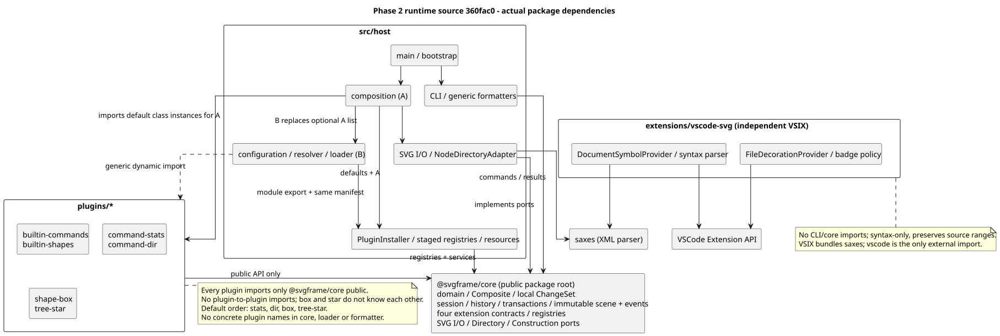
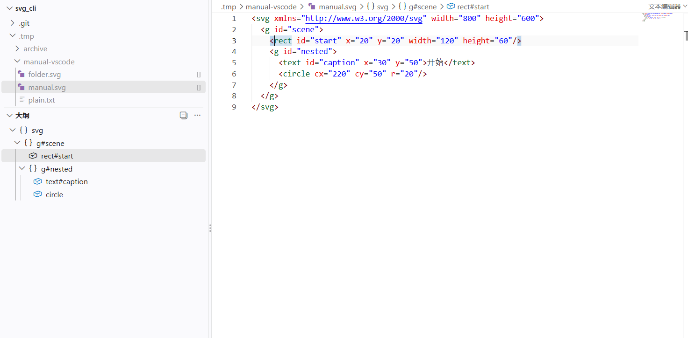
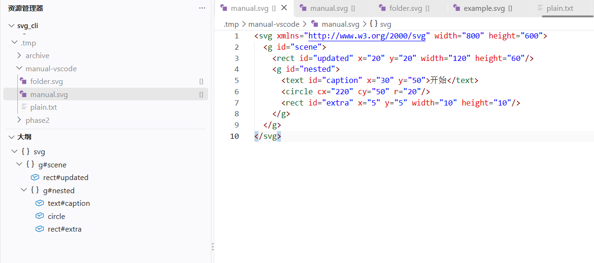

# SVG CLI 项目报告

本文整理SVG编辑器的扩展点、插件装配、架构重构、设计决策及AI协作检查。操作说明见 [用户指南](../README.md)，需求依据为 [第一阶段](../docs/phase_cli_1.md) 和 [第二阶段](../docs/phase_cli_2.md) 需求。

整理日期：2026-11-18。**本轮插件/加载器测试、兼容性验证及VSCode运行结果由作者完成后填写**。下文描述设计与实现，历史指标注明来源；第8节预留实际命令、结论和截图位置，不将旧开发记录作为本轮结果。阶段计划、重复过程报告、旧日志和截图已归入本地 `.tmp/`，不作为报告附件。

## 1. 项目目标与结构

第一阶段实现内置图形、Composite分组、Command撤销重做、文档遍历和SVG读写。第二阶段在保留这些能力的基础上，建立四个稳定扩展点、独立插件包、代码/配置双装配，并实现独立VSCode扩展。

```text
src/core/                 领域模型、应用服务、公开扩展契约与端口
src/host/                 CLI、装配、插件加载、XML和文件系统适配
plugins/builtin-*/        内置图形和命令
plugins/command-stats/    图形统计
plugins/command-dir/      启动目录列表
plugins/shape-box/        复合box、属性处理器、类型标签
plugins/tree-star/        内容差异星号
extensions/vscode-svg/   SVG文件标记与原生Outline
test/                    核心、宿主、加载器和集成测试
doc/transcript/          可复用会话、预期和回放fixture
doc/adr/                 设计决策记录
doc/architecture/        架构图源码与最终渲染
doc/images/              本轮报告截图
docs/metrics/            脚本生成的历史源码指标
.tmp/                    本地过程归档、原始日志，不提交
```

领域层不依赖宿主、Node或具体插件；插件只导入 `@svgframe/core` 的公开包根。宿主负责实例装配、模块解析和外部IO，VSCode包不依赖CLI领域模型。

## 2. 重构前后的架构

### 2.1 重构前

具体命令在应用层，ShapeFactory识别固定类型，入口直接装配已知能力。新增命令、形状或显示行为容易涉及既有工厂、分发和输出逻辑。


图源码：[final.puml](architecture/final.puml)。

### 2.2 重构后

core持有模型、协议和通用服务，内置实现同样通过注册提供。host选择代码对象列表或配置模块列表，两者共用安装事务。输出使用通用结果、几何描述和后缀，核心与渲染器无需按具体插件名分派。



图源码：[phase2.puml](architecture/phase2.puml)。

| 方面 | 重构前 | 重构后 |
|---|---|---|
| 图形创建 | 固定工厂识别类型 | ShapeFactory查询ShapeProvider |
| 命令分发 | 既有具体命令 | CommandDefinition提供语法/help/build，分发器查注册表 |
| 属性编辑 | 节点原有规则 | AttributeHandler可接管，缺省仍走原白名单 |
| 树显示 | 固定基础格式 | TreeDecorator追加后缀，通用formatter组合 |
| 具体实现 | 领域/应用目录内 | builtin-shapes、builtin-commands及独立可选包 |
| 加载 | 固定入口装配 | A代码对象或B配置模块，共同校验与回滚 |
| IO依赖 | 应用拥有文件端口 | 保留端口，并补Directory/Construction端口 |
| 包边界 | 单CLI工程 | core、插件、host与独立VSIX，通过public exports使用 |

Composite、Command、Iterator和局部ChangeSet继续使用；不是重新实现一套领域模型。容器仍支持整体操作，成功编辑保存可逆记录，查询通过只读快照投影。

## 3. 四个扩展点

接口主要位于 `src/core/extensions/Contracts.ts` 和 `src/core/application/commands/Command.ts`。四类注册表独立管理稳定名称和注册顺序，插件获得窄注册接口与受控服务。

| 扩展点 | 职责 | 调用位置 | 正式类实现 | 缺省/失败 |
|---|---|---|---|---|
| ShapeProvider | 离线创建、完整恢复、help及反馈 | ShapeFactory.create/restore/help，CreateCommand与SvgReader消费服务 | 六内置provider、BoxShapeProvider | 未知创建类型报错，未知g标记降级；已安装但损坏拒绝 |
| Command / CommandDefinition | 命令语法、构建、执行和可逆协议 | CommandDispatcher.parse、CommandExecutor.execute、CommandHistory | 内置命令、Stats/Dir的Definition与Command | 缺可选命令报unknown；query不建历史 |
| AttributeHandler | 纯匹配，经AttributeEdits修改部件 | AttributeService.resolve、EditTransaction、SetAttributeCommand | BoxFillHandler、BoxLabelHandler | 零匹配原规则，多匹配先拒绝；失败不回退 |
| TreeDecorator | 读取冻结行上下文，返回可选后缀 | SceneQuery.tree/suffixes、NodeFormatter.tree | BoxTypeDecorator、ModifiedStarDecorator | 空表保持原格式；异常使本次查询失败 |

详细方法、文件路径和错误见 [扩展点参考](EXTENSION_POINTS.md)。public出口不暴露内部树操作符号，插件不导入host、core内部文件或其他具体插件。

### 3.1 属性事务

`handles`只读匹配。单命中时，处理器只获得目标冻结视图和 `AttributeEdits.read/setAttribute`，没有任意可写文档、commit/rollback或外部回调步骤。每个已完成原子变更即时记录；处理器、反馈生成或不变量校验失败时逆序恢复。

一次set仅进入一个历史单元，redo重放既有记录与反馈，不重跑处理器。无匹配保留原节点能力；失败不能悄悄重试默认路径。验证时需比较文档、来源、双栈，并实际undo/redo确认栈中对象可用。

### 3.2 box与完整恢复

BoxShape继承公开SvgGroup，领域语义为box、树基础标题为g、XML为g加data-kind。provider通过ShapeConstructionPort请求rect/text，再由SubtreeBuilder一次组装完整离线子树，不跨插件导入基础实现。

必要直接孩子ID为 `<id>-rect`、`<id>-label`。删除、移出或group收编必要部件拒绝，同父调序和普通编辑允许；整个box可以移动、缩放、迁移、分组或删除。fill只修改本box矩形，label只修改本文本，不向嵌套box递归传播。

读取先验证完整候选子树，再替换会话。provider已注册但结构损坏直接拒绝；未安装provider时未知g标记静默降为普通组，保留合法样式/孩子并移除标记。重复ID在路由前检查，不能因降级被忽略。

### 3.3 内容差异和标签

modified-star按“与最近成功save/read/init内容不一致”判断，而不是编辑次数或历史栈位置。新节点立即标星，undo或普通编辑回原内容消星；失败保存和查询不更新基线。

比较几何、显式属性/文本、类型、父归属、孩子/根顺序及画布。变化传播当前祖先与SVG根；删除/移出由旧父孩子序列体现，单纯画布变化只标根。基线与缓存为每个实例私有字段，成功提交后才接收生命周期通知。

box-type-label先于modified-star注册，输出 `g#id (box) *`。两者互不调用、互不读状态。这里是独立装饰管线，不等同于经典同接口对象包装Decorator。

## 4. 插件装配和加载器

### 4.1 方式A：代码装配

`src/host/composition.ts` 的optionalPlugins返回 `{ module, plugin, options? }` 列表。不带--config时使用它，内置包与可选包都通过PluginInstaller；代码方式也读取同一包清单并校验贡献。

默认顺序为stats、dir、box、tree-star。新增业务通过顶层装配点与必要依赖接入，不应修改core、loader、formatter或已有插件。

### 4.2 方式B：配置装配

```powershell
node dist/host/main.js --config plugins.config.json
```

```json
{
  "plugins": [
    { "module": "@svgframe/command-stats" },
    { "module": "@svgframe/command-dir" },
    { "module": "@svgframe/shape-box" },
    { "module": "@svgframe/tree-star" }
  ]
}
```

显式配置替换A可选列表，内置能力仍安装。条目支持module、enabled、options，相对模块以配置目录为基准，包名遵守该目录Node解析上下文。通用resolver处理包名、目录和明确JS入口；disabled完全不求值，options交给插件判断。

### 4.3 清单校验与失败隔离

package.json的contributes声明shapes、commands、attributes、decorators名称，省略为空。流程为：整体配置校验 → 逐项解析 → 暂存注册/休眠订阅 → 同步activate → 方法/重名/贡献集合检查 → 绑定资源并提交。

当前插件失败时释放其订阅并恢复已提交类别，保留前面成功的插件，继续后续项；重复注册即使被捕获也会使安装失效。退出按逆序释放资源。非法配置只使用内置能力启动，模块缺失/无default/清单不符/激活失败等有固定反馈，见 [装配参考](PLUGIN_LOADING.md)。

loader不含具体插件导入或名称映射。A/B行为一致性与Git接入边界是两种证据：前者比较同集合/顺序/options/cwd下原始输出，后者检查真实接入提交和实际存在的受保护路径，不能仅以工作区空输出证明。

## 5. 目录Adapter与VSCode实践

### 5.1 dir的Adapter角色

Target是公开DirectoryPort，Adapter是NodeDirectoryAdapter，Adaptee是Node readdirSync/Dirent。适配器冻结name/kind和startup path；DirCommand负责点项过滤、分组排序与两空格输出。

目录/文件/链接/其他依次输出，组内使用JS字符串序，隐藏项保留，不递归、不跟随链接、不改变cwd。dir不要求SVG初始化，不改变文档、来源、保存基线或历史；read/save不改变启动目录。

### 5.2 VSCode职责、调用与复用

VSCode负责激活、文件系统、Explorer/Outline展示及导航。扩展注册FileDecorationProvider与DocumentSymbolProvider类实例，宿主按需回调，体现控制反转；ExtensionLifecycle统一管理释放。

文件装饰返回 `[]` 元数据，并未包装文件对象，因此与经典Decorator结构不同。SvgOutlineParser生成保留原始ID和UTF-16范围的语法树，SvgDocumentSymbolProvider将其适配为DocumentSymbol/Position/Range，是较直接的Adapter。

复用saxes和显式栈遍历思路，不直接复用CLI的SvgReader、SvgDocument或历史：大纲应接受无ID、任意合法元素和未保存文本，不补ID或施加课程图形白名单。取消/版本变化时丢弃结果；XML不完整清空，补全后重建。

安装、Text Editor关联、F5和独立宿主方法见 [扩展README](../extensions/vscode-svg/README.md)。实际运行截图与A.3观察结果在第8.4节填写。

## 6. 设计决策

| 决策 | 选择和原因 | 记录 |
|---|---|---|
| 属性失败原子性 | 冻结目标+受控同步事务+局部记录；不接受任意回调冒充原子步骤 | [ADR001](adr/001-attribute-transactions.md) |
| 复合容器与读回 | 通用结构策略、完整后序恢复；仅缺provider的未知g标记降级 | [ADR002](adr/002-composite-restore.md) |
| dirty与标签 | 内容差异、当前祖先传播、box在star前，状态实例私有 | [ADR003](adr/003-lifecycle-and-labels.md) |
| 安装与清单 | A/B共用暂存校验与回滚，禁用不求值 | [ADR004](adr/004-plugin-installation.md) |
| API与宿主边界 | public exports、端口适配、通用构建/解析不枚举新包名 | [ADR005](adr/005-public-api-and-host.md) |

增加注册/事务/加载层会增加代码量和复杂度，换取接入边界，不保证整体更短。策略/处理器要求可信插件遵守同步、纯检查、原子变更契约，不是恶意插件沙箱；不实现热卸载或完整SVG规范。box标题采用固定模板偏移，不声称文字自适应居中。

## 7. AI协作时的检查与修正

以下是开发时检查过的建议，不替代第8节的本轮验证结果。

| AI建议或初始假设 | 核验依据 | 采纳或修正 | 本轮应补证据 |
|---|---|---|---|
| 规范化输出足以证明兼容 | 去提示符/trim/改换行可能隐藏差异 | 增加Buffer级两流和生成物比较 | 第8.3节原始回放 |
| dirty可用编辑次数或历史位置 | 同值、回保存点、canvas历史屏障语义不同 | 内容比较，实例保存基线/缓存 | 第8.1节同值/undo/redo/失败保存 |
| box只需在delete/ungroup按名字保护 | move/group/跨父操作也能破坏部件 | 用通用容器结构策略 | 第8.1节各破坏路径 |
| 先建空组再恢复复合部件 | provider会看见半成品 | 完整离线组装后验证/挂接 | 第8.1节损坏拒绝与原状态保留 |
| Node ESM可直接导入目录 | 目录入口与exports、清单归属有区别 | 通用resolver解析目录/入口/manifest | 第8.2节各路径及依赖失败 |
| 大纲可直接复用SvgReader | CLI补ID/领域校验与语法范围需求冲突 | 仅复用解析库，独立语法DTO和Adapter | 第8.4节无ID/异常恢复 |
| XML列号可直接作编辑器列号 | CRLF/emoji涉及UTF-16偏移 | 用document.positionAt转换偏移 | 第8.4节源码范围与定位 |
| API恢复等同Outline已恢复 | 数据与原生视图刷新有时序差异 | 等待真实可见节点再截图 | 第8.4节恢复截图 |
| 最新类型包一定适合本机 | 类型版本可能高于固定宿主 | 固定兼容依赖并由真实宿主验证 | 第8.4节版本记录 |
| 中间源码指标等同最终标签 | 报告提交与运行源码SHA不同 | 指标明确revision，最后重算并检查源码差异 | 第8.5节最终SHA/命令 |

作者补充记录：

| 日期/建议 | 检查依据 | 采纳/修正 | 实际结果或材料 |
|---|---|---|---|
| 待填写 | 待填写 | 待填写 | 待填写 |

## 8. 测试与验证材料（作者填写）

本节等待作者完成本轮测试、运行并截图后填写。保留命令、日期、版本、退出码和失败修正，不能只填“通过”。原始日志建议放 `.tmp/verification/`，需要提交的截图放 `doc/images/`；不要把机器绝对路径、下载缓存或整个运行目录作为报告附件。

### 8.0 环境

| 项目 | 实际填写 |
|---|---|
| 日期、操作系统、终端 | 待填写 |
| 分支、完整提交SHA | 待填写 |
| Node.js / npm / TypeScript / Vitest | 待填写 |
| VSCode / 扩展版本 | 待填写 |
| 安装、构建命令与退出码 | 待填写 |

准备命令：`npm.cmd ci`、`npm.cmd run build:all`、`npm.cmd run check:tests`。以下PowerShell命令在仓库根执行，其他平台使用npm。

### 8.1 插件与业务功能

```powershell
npm.cmd test --workspace @svgframe/command-stats
npm.cmd test --workspace @svgframe/command-dir
npm.cmd test --workspace @svgframe/shape-box
npm.cmd test --workspace @svgframe/tree-star
```

| 检查项 | 预期观察 | 实际结果、日志或截图 |
|---|---|---|
| stats | 首次类型顺序、根排除、空容器、查询无副作用 | 待填写 |
| dir | 替身/真实目录、隐藏项/排序/链接、失败继续、read/save不变cwd | 待填写 |
| box | 模板/ID冲突、整体操作、部件保护、fill/label与undo/redo | 待填写 |
| SVG恢复 | 完整往返、损坏拒绝、未安装降级、重复ID及失败保留来源/redo | 待填写 |
| 属性事务 | 零/单/多命中，局部失败回滚，一次set一个单元 | 待填写 |
| modified-star | 新建/保存/再编辑/undo/redo/分叉/失败保存/祖先/画布/多会话 | 待填写 |
| 双标签 | `(box) *`顺序、独立禁用、根/子树显示 | 待填写 |

**截图预留：插件功能与Undo/Redo截图待插入。** 建议文件名：`doc/images/plugins.png`、`doc/images/box-undo-redo.png`。

### 8.2 加载器与装配

```powershell
npm.cmd test -- test/loading
npm.cmd test -- test/architecture
```

| 检查项 | 预期观察 | 实际结果、日志或截图 |
|---|---|---|
| A/B共同路径 | 均经过清单校验/安装事务，集合/顺序/options一致 | 待填写 |
| 四类失败 | 缺模块、无default、清单不符、activate抛错后仍可运行 | 待填写 |
| 重复/部分失败 | 当前全部回滚、前者保留、后者继续，资源无残留 | 待填写 |
| 配置与路径 | 非法配置只启内置，disabled不求值，包名/目录/JS按配置目录解析 | 待填写 |
| 内部依赖失败 | 入口存在但内部依赖/求值失败，不误报顶层缺模块 | 待填写 |
| 接入边界 | 真正存在的core/loader/既有插件路径差异为空，解释装配/元数据 | 待填写 |

**截图预留：失败隔离与继续运行截图待插入。** 建议文件名：`doc/images/plugin-loading.png`。

### 8.3 功能兼容性与双装配

```powershell
npm.cmd test -- --maxWorkers=4
$env:SVG_CLI_ENTRY='test/fixtures/entries/no-optional.mjs'
npm.cmd run verify:baseline
Remove-Item Env:SVG_CLI_ENTRY
node scripts/verify-phase2-release.mjs
```

基线工具需要本地正确final标签，会导出该版本并按历史锁安装构建，可能需要网络。A/B必须同实现/集合/顺序/options、初始文件和cwd；比较原始stdout/stderr，不去提示符/trim/改换行。dir会话的日志与保存文件应在被列目录外。

| 检查项 | 作者填写 |
|---|---|
| 全量命令、退出码、文件/测试数量 | 待填写 |
| final标签对象与提交SHA | 待填写 |
| 无插件时与final原始两流和SVG对比 | 待填写 |
| 四插件全集合A/B六份会话、输入/输出哈希与生成物 | 待填写 |
| 实际生成SVG的浏览器查看 | 待填写 |
| 失败、定位、修正和复测 | 待填写 |

**截图预留：兼容性回放、A/B及SVG预览待插入。** 建议文件名：`doc/images/compatibility.png`、`doc/images/assembly-comparison.png`、`doc/images/svg-preview.png`。

### 8.4 VSCode扩展与截图

```powershell
npm.cmd run build:extension
npm.cmd run test:extension:unit
npm.cmd run test:extension
npm.cmd run package:extension
```

还需手工Install from VSIX安装包，或用F5开发宿主运行；以Text Editor打开SVG，查看原生Outline。自动宿主固定1.143.1，首次可能下载；测试只编辑临时fixture，操作JSON与截图在该次 `.tmp/phase2/extension-*/`。安装版自动验证方法见扩展README。

| 场景 | 操作与预期 | 实际观察、版本及材料 |
|---|---|---|
| 文件标记 | 未打开SVG即见`[]`，普通文件/目录无标记，原文件不变 | 待填写 |
| 原生大纲 | 根/容器/叶子/无ID层级正确 | 待填写 |
| 点击定位 | Outline点击节点，编辑器定位对应源码范围 | 待填写 |
| 未保存更新 | 修改ID/层级，视图无需先保存就更新 | 待填写 |
| XML异常恢复 | 不完整时清空，补全后真实视图出现正确节点 | 待填写 |
| 独立安装 | 版本/路径正确，不依赖仓库node_modules | 待填写 |
| A.3实践 | 宿主回调、Decorator/Adapter角色及与CLI复用差异 | 待填写 |

**截图预留：本轮VSCode运行截图待插入。** 建议在 `doc/images/` 保存 `vscode-badge.png`、`vscode-outline.png`、`vscode-navigation.png`、`vscode-updated.png`、`vscode-incomplete.png`、`vscode-recovered.png`，然后用实际图片引用替换预留文字，并填写操作说明。

文件准备好后可使用下面的Markdown引用；当前仅作填写示例，不预置运行截图：

```markdown



```

### 8.5 指标与结论

已有 [源码指标](../docs/metrics/phase2-source.md) / [JSON](../docs/metrics/phase2-source.json) 是脚本从final到运行源码提交 `360fac0` 生成的历史快照，不是本轮验证结论。职责、物理/代码行和复杂度按core/host/plugins分开，VSCode单列；内置迁移会重分配分类，不能把core减少直接当功能净删减。

更新时使用真实revision，例如 `npm.cmd run metrics -- final HEAD --output .tmp/verification/final-to-head`；需要纳入报告的最终结果再放入 `docs/metrics/`，不要手改生成数字。口径见 [指标说明](../docs/metrics/README.md)。

| 最终材料 | 作者填写 |
|---|---|
| 起止完整SHA、版本与生成命令 | 待填写 |
| 实际接入提交和差异说明 | 待填写 |
| 截图/日志清单与尚存限制 | 待填写 |
| 实际完成情况与结论 | 待填写 |
