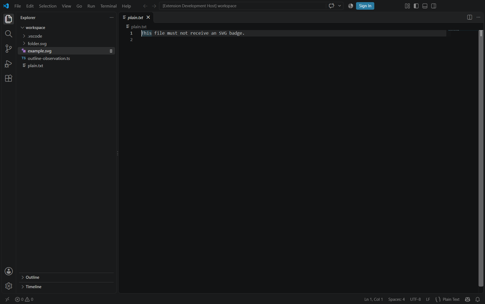
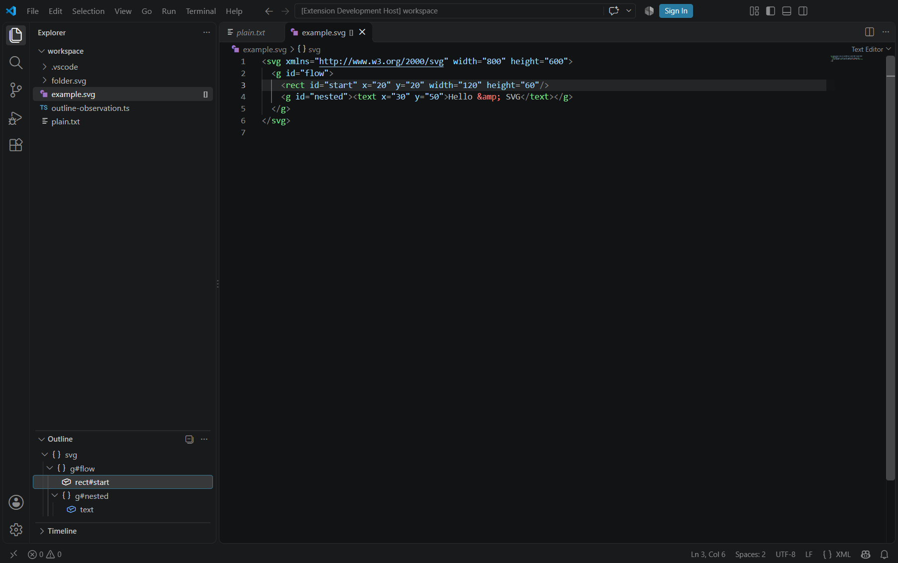
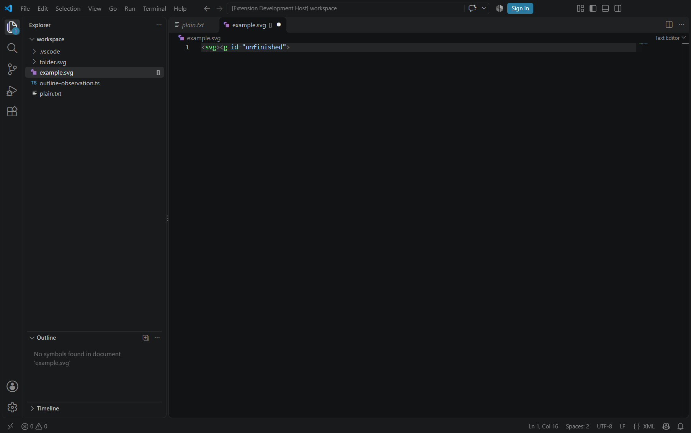

# 第一部分：VSCode SVG 扩展实践

完成日期：2026-11-17。扩展版本 0.2.0；验证宿主 VSCode 1.143.1。源码在 [extensions/vscode-svg](../extensions/vscode-svg)，操作说明在其 [README](../extensions/vscode-svg/README.md)。

P2-6最终复验：从360fac0干净源码/依赖重建扩展，8项单测、开发版及新VSIX独立安装版真实宿主均通过。构建/打包/安装bundle完全相同，归档6文件。最新 [标记截图](evidence/phase2/p2-6-svg-badge.png)、[点击定位](evidence/phase2/p2-6-svg-outline-navigation.png)、[更新](evidence/phase2/p2-6-svg-outline-updated.png)、[异常](evidence/phase2/p2-6-svg-outline-incomplete.png)、[恢复](evidence/phase2/p2-6-svg-outline-recovered.png)、[宿主](evidence/phase2/p2-6-installed-host.json) 与 [VSIX哈希](evidence/phase2/p2-6-vsix.json) 为本轮新证据；下文P2-1b截图保留过程记录。

## 功能、运行与安装

Explorer 的 SVG 文件显示 []；普通文件和目录不标记，不改名或改写内容。以文本方式打开 SVG 后，原生 Outline 展示根、容器和叶子；有 id 使用 标签名#id，无 id 保留标签名。点击节点定位，未保存编辑后更新；XML 不完整时清空，补全后恢复。

```powershell
npm.cmd ci
npm.cmd run build:extension
npm.cmd run test:extension:unit
npm.cmd run test:extension
npm.cmd run package:extension
```

F5 选择 “SVG extension development host” 可打开专用示例工作区。VSIX 在 `.tmp/phase2/svg-cli-companion-0.2.0.vsix`，可从 Extensions → Install from VSIX 安装；不要求发布 Marketplace。实际已验证独立临时目录安装，不依赖个人扩展配置。

**文本编辑器设置是运行条件：**如果 SVG 默认使用 Image Preview，请选择 Text Editor，并在目标工作区设置 `workbench.editorAssociations` 将 `*.svg`/`*.SVG` 关联为 `default`。本实验观察到，直接通过 showTextDocument 临时展示源码而不明确关联时，原生 Outline 导航可能重新打开图片预览。专用 fixture 已配置关联，扩展本身不改用户偏好。详细 JSON 见扩展 README。

## 真实效果与异常恢复







[未保存编辑后的大纲](evidence/phase2/p2-1b-svg-outline-updated.png)、[补全恢复](evidence/phase2/p2-1b-svg-outline-recovered.png)、[宿主验证 JSON](evidence/phase2/p2-1b-outline-checks.json) 补充更新与异常路径。以上是安装版扩展在真实 Electron 窗口中的截图，使用 CDP 捕获，未仿制或重绘界面；需求示例图不作为实现证据。

在实现 SVG 大纲前，已观察内置 TypeScript Outline 的嵌套、源码顺序、折叠/展开、点击定位和编辑更新，见 [P2-1a 记录](../docs/phase2/P2-1a_REPORT.md)。据此选择 DocumentSymbolProvider，而不是自建 TreeView。

## 宿主与插件职责及调用过程（A.3）

| 对象 | 负责内容 | 不承担的职责 |
|---|---|---|
| VSCode | Extension Host、激活调度、文件系统抽象、Explorer/Outline 的渲染、文档版本/取消和导航 | 本项目 SVG 标记和语法树生成 |
| extension.activate | 创建对象、注册 FileDecorationProvider 与 DocumentSymbolProvider、交给 context.subscriptions 管理 | 不扫描/修改用户全部 SVG |
| SvgFileDecorationProvider / SvgBadgePolicy | 根据文件类型返回只读装饰、监听变化并发失效通知 | 不替换文件对象或更改文件名 |
| SvgOutlineParser | 从 XML 生成带 UTF-16 偏移的只读语法树，保留 id/缺 id/嵌套 | 不补 ID，不验证 CLI 的六类图形/几何规则 |
| SvgDocumentSymbolProvider | 把语法节点转换为 DocumentSymbol，产生层级、完整 range 和标签 selectionRange | 不自行实现大纲 UI 或跳转命令 |
| ExtensionLifecycle | 逆序释放注册、监听与事件资源 | 不维护用户文档状态 |

启动后 VSCode 按 onStartupFinished 调用 activate；扩展向宿主注册两个类实例。Explorer 展示文件时回调 provideFileDecoration；文件监听事件通过 onDidChangeFileDecorations 通知宿主重取结果。打开/编辑 SVG 文本时，宿主请求 provideDocumentSymbols，扩展读取当前文档版本与内容、解析并适配，返回 DocumentSymbol.children；用户点击后由原生 Outline 使用范围导航。注销注册项后宿主不再调用对应能力。

因此控制流程从“扩展主动实现界面”转为“扩展注册能力、宿主在适当时机调用”，体现依赖扩展点接口的控制反转。API 对象和注册方式见 [VSCode API](https://code.visualstudio.com/api/references/vscode-api)。

## Decorator 与 Adapter 的对应和差异

经典 Decorator 通常实现与被包装 Component 相同的接口，持有该 Component，委托原行为并叠加职责。这里 FileDecorationProvider 实现宿主的回调接口，返回 FileDecoration 元数据；它没有包装文件对象，也没有实现与文件相同的打开/读写接口。视觉上给文件行附加 []，但不能仅根据 decoration 名字就认定为完整的经典 Decorator 结构。对象组合体现在 provider 持有 policy、watcher、emitter，生命周期持有可释放资源；宿主组合装饰结果与原有文件标签。

Adapter 的对应更直接：宿主需要 DocumentSymbolProvider/DocumentSymbol（Target）；SvgOutlineParser 提供基于偏移的语法树（Adaptee）；SvgDocumentSymbolProvider 是 Adapter，将名称/id/孩子与偏移映射为宿主名称、children 和 Position/Range。它适配的是数据协议，保留语法解析与宿主 UI 的边界。

文件标记同样把 workspace.fs 的 FileStat 与路径信息适配为宿主的装饰元数据，但其主要契约仍是 provider 回调。模式分析以实际接口、持有对象和调用关系为依据，不将所有 provider 都泛称为 Decorator。

## Phase 1 复用评估

| 模块 | 决策 | 原因与实际落点 |
|---|---|---|
| saxes 6.0.0 | 复用解析库 | 已支持命名空间、XML 结构和错误事件；本扩展独立管理偏移/语法树 |
| SvgReader | 不直接复用实现 | 它校验画布尺寸/允许属性和六类图形、补 ID、构建领域候选，且不提供源码范围；与只读大纲需求不匹配 |
| SvgNode/SvgDocument | 不作为大纲模型 | 要求全局 ID 与领域几何/归属不变量，大纲需接受无 id、任意合法元素并包含根 SVG |
| 领域遍历思想 | 复用思路，独立实现 | 使用显式栈构造/投影，避免深层输入递归溢出；大纲输出是语法 DTO，不导入 CLI 树实现 |
| CommandHistory/IO 写入 | 不复用 | 扩展只读，编辑由 VSCode 管理；另建撤销或保存逻辑会干扰用户编辑器 |

这一取舍保持 VSCode 包与 CLI 分离。CLI 内部模块后续迁移时，不影响本扩展的运行依赖。没有为了代码复用而强迫用户 SVG 满足课程 CLI 的受限规范。

## 范围与构建验证

parser 使用 saxes 的流偏移定位标签，保留 XML 原始名称（含前缀）和未命名元素；DocumentSymbol 的 selectionRange 指向起始标签名，range 包括完整元素。使用 document.positionAt 将 UTF-16 偏移转换为行列；不使用按 Unicode 字符计数的 XML column 充当编辑器列数。CRLF、emoji、多行属性、同一行多个元素、注释/CDATA、自闭合和 2000 层嵌套均有测试。

每次从当前文本重建，解析失败返回空树，不缓存上次合法大纲；取消/版本变化丢弃结果。DOCTYPE 拒绝且不加载外部实体。本版本只匹配 file URI 的 SVG 路径（大小写扩展名均支持），不支持 untitled 或完整 SVG 规范校验。

VSIX 包含 bundle、manifest、README 和示例。构建元数据确认 saxes/xmlchars 纳入 bundle、唯一外部模块为 vscode；[包哈希与构建输入](evidence/phase2/p2-1b-vsix-package.json)、[归档文件清单](evidence/phase2/p2-1b-vsix-entries.json)、[已安装路径与宿主版本](evidence/phase2/p2-1b-host.json) 可核验。打包方法参照 [官方 bundle 文档](https://code.visualstudio.com/api/working-with-extensions/bundling-extension) 和 [VSIX 打包文档](https://code.visualstudio.com/api/working-with-extensions/publishing-extension)。
