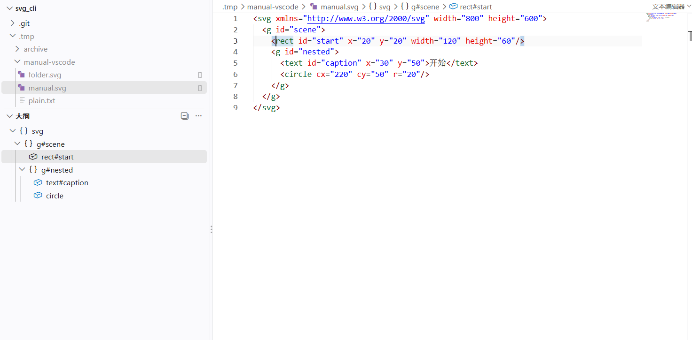

# VSCode 插件人工测试指南

适用插件：**SVG CLI Companion**，扩展ID为 `svgframe-local.svg-cli-companion`，当前项目版本0.2.0。

你看到的 `[]` 是“文件标记”功能。另一组主要功能在 **VSCode原生Outline／大纲视图**：SVG层级、源码定位、未保存编辑更新、XML错误后恢复。图形创建、box、stats等命令属于终端中的SVG CLI，测试它们请使用 [项目报告](README.md) 的插件/CLI章节。

本指南只说明操作和预期，结果由你实际执行后填写。截图放 `doc/images/`，原始日志和临时测试文件放 `.tmp/`。

## 1. 只看到[]：先做这三步

先在扩展详情确认版本为本项目当前的0.2.0；低于该版本时，按第2节更新本地构建的安装包。已经使用当前版本并能看到标记时，先不用重新安装或构建：

1. 打开仓库里的 `extensions/vscode-svg/fixtures/example.svg`。如果出现图片，右键编辑器标签，选择 **Reopen Editor With…／重新打开编辑器方式… → Text Editor／文本编辑器**。你应该看到以 `<svg` 开始的XML源码。
2. 按 **Ctrl+Shift+E** 打开资源管理器，在左侧底部找到 **Outline／大纲** 并展开。找不到时，按 **Ctrl+Shift+P**，搜索 **View: Open View…／查看: 打开视图…**，在视图列表中搜索并选择 **Outline／大纲**。菜单名称可能随界面语言不同。[Outline位置与打开视图说明](https://code.visualstudio.com/docs/editing/getting-started/userinterface#outline-view)
3. 确认当前活动标签仍是这个SVG文本文件，逐层展开大纲里的 `svg`、`g#flow`。应看到 `rect#start`、`g#nested` 和没有ID的 `text`。点击 `rect#start`，源码应定位到第3行。

看到这棵树，就说明已经找到扩展的主要入口：

```text
svg
└── g#flow
    ├── rect#start
    └── g#nested
        └── text
```

Outline展示的是**当前活动编辑器**的符号。点回README、终端中的文件链接或其他文本后，大纲可能跟着切换；测试时重新选中SVG标签。

### 防止大纲点击后又进入图片预览

如果每次点击大纲又打开图片，在测试文件所在工作区的 `.vscode/settings.json` **合并**下面的配置，不要覆盖已有其他设置：

```json
{
  "workbench.editorAssociations": {
    "*.svg": "default",
    "*.SVG": "default"
  }
}
```

关闭该SVG标签后重新以Text Editor打开，再尝试定位。本项目 `extensions/vscode-svg/fixtures/` 工作区已带此设置；不必修改用户全局偏好。

## 2. 选择测试方式

两种方式任选一种，并在记录中注明实际使用的窗口。已安装且能看到 `[]` 时可直接用方式A，继续第3节。

### A. 测试已安装VSIX

需要重新打包或安装时，在仓库根目录执行：

```powershell
npm.cmd ci
npm.cmd run package:extension
```

在VSCode扩展视图的 `…` 菜单选择 **Install from VSIX…／从VSIX安装…**，也可在命令面板搜索 **Extensions: Install from VSIX…**，选择 `.tmp/phase2/svg-cli-companion-0.2.0.vsix`，按提示重新加载窗口。[官方VSIX安装说明](https://code.visualstudio.com/docs/configure/extensions/extension-marketplace#install-from-a-vsix)

在扩展详情确认名称、版本以及当前工作区启用状态。扩展声明支持VSCode `^1.143.1`；遇到不兼容提示时记录实际宿主版本，不应把安装失败当成功。

### B. 测试F5开发宿主

1. 在原VSCode窗口打开**仓库根目录**，执行 `npm.cmd ci`。
2. 打开“运行和调试”，选择 **SVG extension development host**，按 **F5**。
3. 等待构建和启动，转到新开的 **Extension Development Host／扩展开发宿主** 窗口。它打开的是本项目fixtures工作区。
4. 后续查看标记、打开SVG和操作Outline，都在**新窗口**中进行；原窗口用来编辑扩展源码。

F5已经配置构建任务，无需另行运行CLI。开发宿主使用独立用户数据和扩展目录，不能用原窗口的已安装列表推断新窗口的状态。修改扩展源码后重新启动调试；只修改测试SVG时不需要重新构建。

## 3. 准备自己的测试文件

快速体验可以读原有example.svg；编辑测试建议使用副本，避免修改正式示例。

在仓库根目录终端执行以下命令建立忽略目录：

```powershell
New-Item -ItemType Directory -Force -Path .tmp/manual-vscode
```

在已安装扩展的窗口中可打开这个文件夹作为测试工作区；在F5宿主中，可用 **File → Add Folder to Workspace…／文件→将文件夹添加到工作区…** 加入它，继续使用当前开发宿主。

在该目录新建并保存 `manual.svg`，粘贴以下**9行**内容。关闭自动保存，以便单独观察未保存更新；第1节的文本编辑器关联应对测试文件所在工作区生效。

```xml
<svg xmlns="http://www.w3.org/2000/svg" width="800" height="600">
  <g id="scene">
    <rect id="start" x="20" y="20" width="120" height="60"/>
    <g id="nested">
      <text id="caption" x="30" y="50">开始</text>
      <circle cx="220" cy="50" r="20"/>
    </g>
  </g>
</svg>
```

再创建普通文件 `plain.txt` 和目录 `folder.svg`。这些都放在 `.tmp/manual-vscode/`。可把后续对manual.svg的修改撤销，随时恢复到上述基准内容。

## 4. 逐项人工测试

每项按“操作→预期”检查。刷新需要短暂时间；必要时拉高Outline面板、展开节点、清空搜索框。不要用重新加载窗口代替本来要测试的“实时更新”。

### M01：文件标记、目录排除和自动激活

**操作：**关闭所有SVG标签，保留普通文本文件。展开Explorer中的测试目录，观察manual.svg、plain.txt、folder.svg和它们的父目录。

**预期：**

- manual.svg行尾显示 `[]`，不要求先打开文件；鼠标悬停标记可看到 `SVG file` 提示。
- plain.txt和目录folder.svg没有本扩展的标记，父目录也不因含SVG而追加 `[]`。
- 文件名仍为manual.svg，`[]`只是UI装饰，不是实际文件名的一部分。

截图建议：`doc/images/vscode-badge.png`，同时包含正例和两个反例。

### M02：新建、重命名和删除刷新

**操作：**在测试目录新建 `refresh.svg` 并保存合法SVG；观察后将它重命名为 `refresh.txt`，再改回 `refresh.svg`，最后删除这个临时文件。

**预期：**保存为.svg时出现标记，改为.txt后不再标记，改回.svg再次出现，删除后Explorer不留下旧条目。测试过程中不用重载窗口。这里只删除刚创建的临时文件。

### M03：原生大纲层级、折叠和无ID节点

**操作：**以Text Editor打开第3节基准manual.svg，展开Outline全部层级。若开启了按名称或类型排序，切回按源码位置排序再比较；清空大纲过滤输入。

**预期：**

```text
svg
└── g#scene
    ├── rect#start
    └── g#nested
        ├── text#caption
        └── circle
```

折叠g#nested后只隐藏它的两个孩子，展开后恢复。circle没有ID，因此只显示circle，**不会自动生成circle1**。大纲显示标签名与ID，不展示完整的几何或文本属性。

截图建议：`doc/images/vscode-outline.png`。

### M04：点击定位到源码

**操作：**先把光标放到文件最后一行，再在Outline中点击 `rect#start` 的文字；随后点击 `text#caption`。

**预期：**分别跳到第3行的rect和第5行的text起始标签附近。仍显示XML源码，不切换到图片预览。可以通过右下角行号或编辑器高亮确认；只点折叠箭头不算完成导航测试。

截图建议：`doc/images/vscode-navigation.png`，同时显示Outline选中项与源码行号。

### M05：未保存编辑实时更新

**操作：**保持manual.svg打开，将第3行 `id="start"` 改为 `id="updated"`，暂不按Ctrl+S。再在g#nested内部新增一个完整元素：

```xml
<rect id="extra" x="5" y="5" width="10" height="10"/>
```

**预期：**标签上仍有未保存标识时，Outline已经将rect#start替换为rect#updated，并在nested下新增rect#extra；点击新节点能定位。Ctrl+Z撤销改动后，大纲也恢复。

只把文本正文“开始”改为“结束”时，`text#caption` 的标题保持不变，这是正常的：标题来源是标签名和ID，不是正文。输入过程中XML暂时不完整而短暂清空也正常，应在元素闭合后恢复。

截图建议：`doc/images/vscode-updated.png`，包含未保存标识和更新后的节点。

### M06：错误XML清空与补全恢复

**操作：**先恢复并保存基准内容。暂时把编辑器全部内容替换为下面的不完整文本，不保存：

```xml
<svg><g id="unfinished">
```

**预期：**Outline变空或显示“未找到符号”，原来的scene/start节点消失，窗口和扩展仍能操作。`[]`仍可以存在，因为文件分类与XML语法是两个独立功能。

**恢复：**用Ctrl+Z还原，或重新粘贴第3节完整内容。待Outline刷新、展开后，确认scene、start和nested重新可见，且start仍能点击定位。

截图建议：`vscode-incomplete.png`和`vscode-recovered.png`，两张都保存到 `doc/images/`。

### M07：切换活动文件和多文件隔离

**操作：**复制基准内容到 `second.svg`，把scene的ID改为second-scene并保存。在manual.svg与second.svg标签间切换，再打开plain.txt。

**预期：**Outline跟随当前活动SVG，分别显示scene或second-scene；不会混合两份文件的节点。切到plain.txt后，不应继续把manual.svg的树当作当前文档树。切回manual.svg后恢复其层级。

### M08：大写扩展名、XML语言模式与一般SVG元素

**操作：**另存一份基准文件为 `UPPER.SVG`，以Text Editor打开。通过右下角语言模式菜单选择XML，观察标记和大纲。再在nested内插入合法元素：

```xml
<path id="outline-path" d="M 0 0 L 10 10"/>
```

**预期：**UPPER.SVG有标记和大纲，XML语言模式下仍工作，新增path#outline-path可见并能定位。这是语法大纲，允许CLI未提供的元素；不能用CLI的六图形限制来判断本项失败。

### M09：中文、emoji、多行标签与位置

**操作：**在一个新的 `ranges.svg` 中保存并打开下面内容，点击大纲中的s:g#中文和rect#范围。可在状态栏把行尾格式切为CRLF后再试。

```xml
<svg xmlns="http://www.w3.org/2000/svg" xmlns:s="http://www.w3.org/2000/svg">
  <!-- 😀 中文 -->
  <s:g
    id="中文">
    <rect id="范围"/>
  </s:g>
</svg>
```

**预期：**保留命名空间前缀和中文ID；点击分别定位到第3行的s:g和第5行的rect，不因前面的emoji或CRLF跳错行。标签跨行时，导航目标仍是起始标签名，而不是ID所在行。

### M10：不支持的文档输入及恢复

**操作：**在临时SVG副本中分别测试 `<root/>`，以及下面的带DOCTYPE文本；每次之后恢复为完整基准内容：

```xml
<!DOCTYPE svg>
<svg xmlns="http://www.w3.org/2000/svg"/>
```

**预期：**非svg根或DOCTYPE输入不产生大纲；恢复合法SVG根后重新生成。这一视图不承担完整SVG规范/几何校验，能生成大纲不表示所有几何属性都合法。此测试不需要也不要加入外部实体引用。

### M11：只读性、保存和重新打开

**操作：**从第3节基准内容另存一个 `readonly.svg`，不要编辑它。只执行打开、折叠、展开、点击和关闭；对比操作前后文件名和内容。需要更明确的记录时，在仓库根目录的PowerShell运行两次：

```powershell
Get-FileHash .tmp/manual-vscode/readonly.svg -Algorithm SHA256
```

**预期：**前后哈希相同，没有新增ID、改名或自动写文件；未编辑的文件不会因导航变为未保存。主动输入/保存过的其他测试文件内容发生变化，不属于扩展擅自修改。

重新打开readonly.svg后仍可展示和导航。关闭所有SVG并重新加载测试窗口后，先只看Explorer，文件标记应能自动出现；打开SVG文本才查看其大纲。

## 5. 常见现象与排查顺序

| 现象 | 优先检查 |
|---|---|
| 只有[]，没看到树 | 打开的是SVG的XML文本吗？当前活动标签是SVG吗？Outline面板是否显示并展开？按第1节操作。 |
| 左侧只有svg一项 | 展开svg及各g的箭头；清空Outline过滤，拉高面板。 |
| 点击后变成图片 | 为测试工作区合并第1节editorAssociations，重新以Text Editor打开。 |
| 改了文字但树标题不变 | 改的是文本正文还是ID？标题只由标签名与ID生成，使用M05检查ID/结构变化。 |
| 输入时树突然消失 | XML暂时不完整；先恢复完整基准文本，再判断是否异常。 |
| 已恢复却仍空 | 确认活动文件、保存为真实.svg文件且根为svg，XML闭合且无DOCTYPE，再检查过滤/折叠。 |
| 节点名称、层级重复或无效XML仍有旧树 | 可能还有其他SVG/XML符号提供扩展；可仅在当前工作区暂时禁用同类扩展后复测，保留SVG CLI Companion。 |
| 普通窗口有标记，F5新窗口没有 | 两个窗口的扩展目录不同；检查新窗口是否真正作为开发宿主启动、构建任务是否成功。 |
| 装了旧包，修改源码没变化 | 已安装VSIX不会自动替换为源码；重新打包安装，或选择F5开发宿主。 |
| 新建未命名文档没有大纲 | 先保存到磁盘为.svg；当前提供者匹配file路径，不覆盖untitled编辑器。 |
| .svg.txt没有标记 | 实际后缀是.txt，属于预期排除。确认系统没有隐藏扩展名导致误认。 |

需要重载时，在命令面板运行 **Developer: Reload Window／开发人员: 重新加载窗口**。先记录失败现象和当前状态，再重载；不要把重载后恢复当作“无需重载实时刷新”已通过。

仍有问题时，记录VSCode/扩展版本、安装或F5方式、完整测试文本、实际视图与报错。可查看“输出”中的 **Log (Extension Host)** 或开发者工具日志；本扩展没有自建业务日志面板。

## 6. 记录与截图清单

在 [项目报告第8.4节](README.md) 汇总结果。可以复制下面的表，不预先勾选通过；失败时补充修正和复测。

| 项目 | 结果：通过/失败/未执行 | 实际观察、截图或失败修正 |
|---|---|---|
| 环境：日期、VSCode/扩展版本、安装或F5方式 | 待填写 | 待填写 |
| M01 标记/目录排除/自动激活 | 待填写 | 待填写 |
| M02 文件变化刷新 | 待填写 | 待填写 |
| M03 层级/折叠/无ID | 待填写 | 待填写 |
| M04 点击定位 | 待填写 | 待填写 |
| M05 未保存更新 | 待填写 | 待填写 |
| M06 错误清空与恢复 | 待填写 | 待填写 |
| M07 多文件切换 | 待填写 | 待填写 |
| M08 大写路径/XML语言/一般元素 | 待填写 | 待填写 |
| M09 中文/emoji/多行/CRLF定位 | 待填写 | 待填写 |
| M10 不支持输入与恢复 | 待填写 | 待填写 |
| M11 只读性与重新打开 | 待填写 | 待填写 |

核心截图建议至少包括标记、完整大纲、点击定位、未保存更新、异常清空和补全恢复六张。截图同时保留文件名、源码和相关Outline部分，避免只截一个孤立提示。文件放好后在报告中插入，例如：

```markdown

```

人工测试不能直接证明取消令牌、过期文档版本丢弃、订阅释放等内部时序。需要补充自动化证据时使用 `npm.cmd run test:extension:unit` 和 `npm.cmd run test:extension`，并把它们与人工操作结果分别记录。安装版与开发版也要分别标注，不能只运行一种就声称两种都通过。
