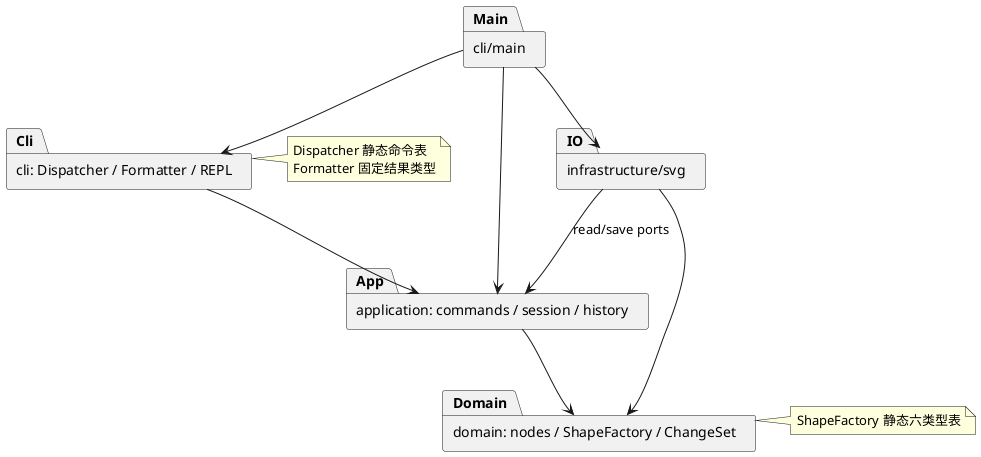
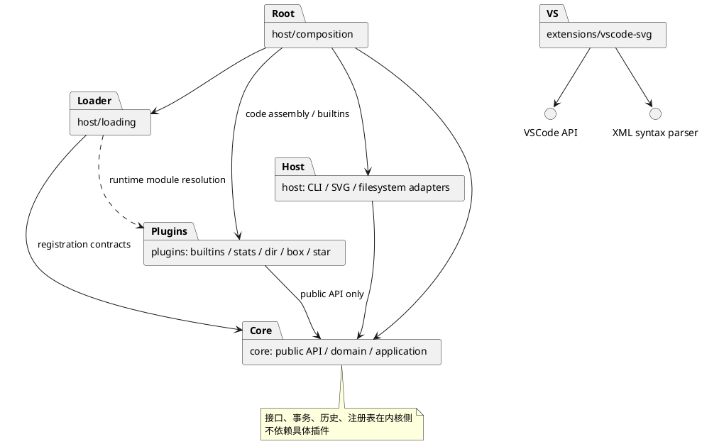

# Phase 2 需求与架构梳理（首轮评审）

评审日期：2026-11-16。依据：[第二阶段需求](phase_cli_2.md)、[第一阶段语义](phase_cli_1.md)、两张配套图片及当前源码。

> 后续状态更新（2026-11-16）：用户已采纳建议设计；本地 final 标签已核对正确。最新设计决策、环境检查和分阶段计划见 [docs/phase2 开发入口](phase2/README.md)。以下保留首次评审的历史快照，涉及“标签尚无”“决策待定”的描述不再作为当前状态。

本文是开发前的分析与建议，不代表接口已经实现或 ADR 已批准；本轮仅新增本文，不开展第二阶段功能开发。后续正式交付仍以 `doc/README.md` 为总入口。

## 1. 结论与当前基线

**需要调整架构，但可以沿用现有分层、Composite、Command 和局部变更记录，不需要重写编辑器。** 第二阶段的主要工作不是增加几个命令，而是把目前“允许集中修改的分派位置”变成“新增实现无需修改的扩展边界”。VSCode 扩展是另一项必做交付，不能用 CLI 的插件机制替代。

建议顺序：固定兼容基线 → VSCode 实践与复用评估 → 框架重构并冻结扩展契约 → 命令插件 → box 的双装配证明 → 标签集成 → 综合验收与报告。

### 已核实的事实

| 项目 | 当前结果 | 对本阶段的影响 |
|---|---|---|
| 当前 HEAD | `0ebd382699f345699032eea05688b47ecd854340`（添加二阶段开发需求） | 开始梳理时工作区干净 |
| Phase 1 候选基线 | `2054ec5667ad2e5f16b9b52ddd75a3435ed63c9d`，提交消息为 `final` | HEAD 相对该提交只新增 Phase 2 需求和两张图片，运行代码相同 |
| 本地标签 | `git tag --list` 无输出 | **提交消息 final 不等于 final 标签**；尚未查询远端标签，不据此判断远端也没有 |
| 构建 | `npm.cmd run build` 通过 | 当前 TypeScript 基线可编译 |
| 测试 | 24 个测试文件、214 项通过 | 首次在沙箱中启动受 `spawn EPERM` 阻挡，获准重跑后通过；不是用历史报告代替本轮测试 |
| 实际环境 | Node `v24.14.0`、npm `11.9.0` | 保持既有 TypeScript/ESM 工程，扩展宿主单独验证运行目标 |
| 文档 | 根 README 的“待最终提交”描述已落后于 Git 记录 | 后续更新报告时同步校正，不能只据 README 推断交付状态 |
| 本地旧设计 | `docs/ARCHITECTURE.md`、`DEVELOPMENT_PLAN.md`、`CODEX_PROMPT.md` 被 Git 忽略 | 可以参考，不应让第二阶段唯一设计或过程证据继续落在忽略文件中 |

本轮实际查看了标记图和大纲图：目标是 Explorer 行尾的 `[]` 与原生 Outline 的嵌套/源码定位，不是更换图标、自建树视图或图形预览。需求 Markdown 中的 `docs/images/...` 相对于其所在 `docs/` 会形成重复路径；实际资源在 `docs/images/`。后续可单独修正相对链接为 `images/...`，本轮不修改需求原文。

## 2. 必做工作与验收映射

| 工作包 | 具体工作 | 完成证据 |
|---|---|---|
| V1：VSCode 文件标记 | 扩展工程、激活与释放、SVG 文件识别、排除目录/非 SVG、返回 `[]` | 扩展源码、安装/调试步骤、真实运行截图、文件名和内容不变的验证 |
| V2：原生大纲 | 先观察原生视图；解析根/容器/叶子；标签与 id；源码范围；更新与异常容错 | 嵌套、无 id、编辑后更新、不完整 XML 测试；点击定位截图与异常恢复证据 |
| V3：模式与复用分析 | 宿主调用链；文件装饰与 Decorator/Adapter 的异同；Phase 1 复用评估 | `doc/README.md` 的分析章节，不能仅罗列模式名称 |
| F1：稳定内核与扩展 API | 四个扩展点；公开领域 API；注册表；内置命令与六种形状经注册装配 | 禁用可选插件时全部 Phase 1 回归；扩展点接口/调用位置/契约清单 |
| F2：双装配与加载器 | 同一安装事务；模块解析；配置、manifest、重复名校验；激活失败回滚 | A/B 相同行为；全部失败路径测试；加载器没有具体插件映射 |
| C1：stats | 独立包；DFS 首次出现顺序；容器与叶子分类；动态 help | 空文档、嵌套 g/box、计数顺序、禁用、历史不变 |
| C2：dir | 独立包；目录接口与 Node 适配器；稳定排序；错误恢复 | 替身测试、临时目录组合测试、未初始化可用、成功/失败均不改变文档和历史 |
| S1：box | 创建子树、复合类型身份、移动/嵌套、读写、子部件保护 | ID 冲突原子失败、往返/降级、结构不变量、单独测试、版本 B 会话 |
| A1：属性语义 | handler 优先，原规则兜底；fill/label；冲突规则；统一事务 | 每次 set 单独 undo/redo；部分修改失败后状态和双栈不变 |
| T1：树标签 | `(box)` 与 modified-star；稳定拼接；保存与编辑状态 | 标签互不感知；禁用后 tree 字节不变；状态机和多会话隔离测试 |
| Q1：过程与交付 | 提交边界、回放、PlantUML、ADR、历史指标脚本、AI 建议检查记录 | 普通过程提交、最终 p2；可复现的指标和差异证据 |

不纳入必做范围：diamond/arrow/swimlane、第五个扩展点、热插拔、插件市场、完整 SVG 规范、图形预览、VSCode Web 扩展。需求中的配置示例不代表必须实现 diamond 或 export-png。

## 3. 现有架构哪些保留，哪些必须改

### 3.1 可保留的基础

- `SvgNode`、`SvgGroup`、`SvgDocument` 的封装、Composite 与迭代思想；文档维护 ID、父引用与顺序。
- `ChangeSet` 的局部可逆记录，以及 `CommandHistory` 成功后入栈、失败保留历史的原则。
- `CommandTokenizer` 对引号、注释及参数的处理；尤其不能丢失 `quoted` 信息，破坏末尾 `in` 的既有语义。
- 读取先构造候选文档再替换会话、保存先完整序列化再原子写入的策略。
- `SceneQuery` 的只读投影、`NodeFormatter` 的通用几何描述；无标签时继续使用相同文本布局。
- 已有 214 项回归和精确输出 fixture。迁移测试导入路径可以做，不能把期望值改成新输出来“通过兼容”。

### 3.2 已定位的改造点

| 当前位置与函数 | 当前限制 | 建议调整 |
|---|---|---|
| `src/cli/CommandDispatcher.ts` 构造函数、`parse`、`create` | 直接导入全部命令，构造固定表；help 手写六类型语法 | 分词后只查注册表；内置包提供命令定义/参数校验/help；图形 provider 提供 create 帮助 |
| `src/domain/ShapeFactory.ts` `create`、`fromAttributes` | 直接引用五个叶子和 g，白名单/参数固定在 Map | 成为只消费 ShapeProvider 的注册式解析服务；具体 schema/创建/恢复进入内置 provider |
| `src/application/commands/CreateCommand.ts` `execute` | 内部 `new ShapeFactory()` | 注入公开创建服务；创建完整离线子树后统一挂接 |
| `src/application/commands/SetAttributeCommand.ts` `plan`、`result` | 直接调用默认属性规则，结果从目标自身取值 | 先解析 AttributeHandler；处理器给出语义结果，不能从 box 自身读取子矩形 fill 或虚拟 label |
| `src/domain/ChangeSet.ts` `apply`、`revert` | 仅回滚已完成步骤，单步要求原子性 | 保留为底层机制，增加受控编辑事务；不把任意插件回调直接包装成一个原子步骤 |
| `src/application/commands/NodeEditCommand.ts` `execute`/`undo`/`redo` | 修改后再调用 `result`；结果生成抛错时没有统一恢复 | 将插件操作、结果校验和提交纳入同一失败边界，补充 execute/undo/redo 失败测试 |
| `src/application/CommandExecutor.ts`、`CommandHistory.ts` | 编辑协议依赖具体 `EditCommand`，扩展生命周期信息不足 | 将可逆命令协议/可复用基类纳入公开 API；执行器按协议消费，成功后发布语义事件 |
| `src/application/CommandResult.ts`、`src/cli/ResultFormatter.ts` `format` | 封闭联合类型与固定 switch，无法表示新增命令结果 | 框架阶段增加通用只读文本行结果；后续 stats/dir 不扩展 switch；保留内置输出 |
| `src/domain/SvgDocument.ts` `requireContainer`/`insert`/`remove`/`planRelocate` | 容器依赖 SvgGroup；只有通用树约束，没有复合部件保护 | 公开稳定的容器基类/能力、离线子树构建和通用结构策略钩子；禁止插件使用 internal 符号 |
| `src/domain/SceneEditor.ts` `planUngroup`、`planGroup` | 只判断 SvgGroup 与层级，无法识别禁止解散的复合容器 | 委托容器公开策略；子部件移出限制覆盖 delete/addto/group，不能只拦截 ungroup |
| `src/infrastructure/svg/SvgReader.ts` `buildCandidate` | 父先创建；仅按 XML 标签恢复，不能完成复合子树验证 | XML 输入结构与语义恢复分开；先预留/补全 ID，再按 provider 构建完整子树或延迟验证 |
| `src/infrastructure/svg/SvgWriter.ts` `serialize`、`close` | XML 标签使用 `node.type`，属性全部来自语义属性 | 区分领域类型、XML 描述、树行显示；提供通用序列化描述，不能输出 `<box>` |
| `src/application/SceneSnapshot.ts`、`SceneQuery.ts` | type 同时承担命令与显示身份；缺容器能力和标签上下文 | 明确 semanticType、显示标签、isContainer、必要元数据；保留既有节点输出 |
| `src/cli/NodeFormatter.ts` `tree` | 无标签管线；根行与普通行分开构造 | 框架阶段统一行上下文和装饰调用；新标签只返回后缀，不自行改树缩进 |
| `src/application/EditorSession.ts` | 只有文档与来源路径，没有保存点和生命周期通知 | 公开只读会话状态/成功事件；dirty 状态由标签实例维护，不混入 history barrier |
| `src/cli/main.ts` | 只装配固定实现 | 明确组合根、默认内置装配、代码可选装配、配置加载器 |
| `test/architecture/dependencies.test.ts`、构建配置 | 当前只检查 src 四层，构建只含 src，测试只含 test | 覆盖插件包/扩展包/public 边界及各自构建；不能通过漏扫目录获得“无违规” |

一个重要区别：已有 `SvgDocument.insert` 会检查**整棵子树**的 ID，因此可复用其提交前验证；但目前插件没有公开、安全地组装离线子树的入口。二者不是同一项能力。

## 4. 建议的模块边界

采用单仓库内的明确包边界；可用 npm workspaces 管理独立插件包，不需要引入复杂的构建平台。以下是建议目标，不要求第一步就机械搬动全部文件。

```text
src/
  core/
    domain/                 # 公共领域抽象、容器、文档、事务基础
    application/            # 会话、历史、查询、通用扩展调用
    extensions/             # 四个扩展点、注册协议与上下文
    public.ts               # 插件允许导入的公开出口
  host/
    cli/                    # REPL、分词、分发、通用渲染
    svg/                    # XML 读写与原子文件存储适配器
    filesystem/             # Node 目录适配器
    loading/                # 通用配置/模块加载/安装事务
    composition.ts          # 顶层装配，代码方式唯一运行代码修改点
    main.ts                 # 稳定启动入口
plugins/
  builtin-shapes/            # 六个 ShapeProvider；具体叶子实现
  builtin-commands/          # Phase 1 命令与帮助元数据
  command-stats/             # 独立 package.json + contributes
  command-dir/               # 独立 package.json + contributes
  shape-box/                 # box、属性处理器、box-type-label
  tree-star/                 # modified-star 及实例状态
extensions/
  vscode-svg/                # 独立扩展工程、源码范围解析、宿主测试
scripts/                     # 回放、差异证明、指标生成
doc/transcript/               # 纯命令输入；输出/输入 SVG 另存
doc/adr/                     # 正式决策记录
docs/metrics/                 # 脚本生成的数据与说明
```

`SvgGroup` 可演化为公开的通用容器实现；g 的创建/读回注册仍由内置 provider 提供。对容器进行能力判断不是按 `box` 名称分支，不必为了接口数量把所有已有类推翻。box 创建基本子部件应使用内核公开的几何/节点构建能力，或注入的 `ShapeConstructionPort`；选择后者时，生产由已装配的基本形状服务满足，单测用替身，box 包不直接 import builtin-shapes。

依赖规则：内核不导入插件、宿主或 Node 文件系统；插件只导入 public API，不导入 `internal`、loader、composition 或其他插件；宿主实现端口；只有组合根知道默认装哪些具体实现。public.ts 只导出承诺支持的抽象/基类，不是把所有内部文件重新导出。

### 重构前依赖图（概括现有代码）



### 重构后依赖图（建议）



两图是待实施方案的源码图，不是已经完成的架构验收。正式报告要对应最终路径与代码更新。

## 5. 四个扩展点的拟定契约

下表列的是拟新增接口与调用点，不能作为已交付的扩展点清单。实施后需补真实文件/方法、测试和错误样例。

| 接口 | 责任与拟调用位置 | 实现 | 缺省行为 | 契约失败处理 |
|---|---|---|---|---|
| ShapeProvider | 参数/help、创建离线子树、从标准化 SVG 输入恢复；注册式 ShapeFactory.create/restore 调用 | 六内置 provider、BoxShapeProvider | 六类型仍可用；未知 create 保留原错误；未知复合标记按规则降级 | 重复注册拒绝插件；非法参数/子树/ID/读回结构使当前命令失败，原文档不变 |
| Command | 命令定义提供 name、参数校验、help、构建命令实例；Dispatcher.parse 查表，Executor.execute 调用 | 内置命令、StatsCommand、DirCommand | Phase 1 命令保留；未加载的 stats/dir 报 unknown command | 重复命令名拒绝当前插件；query 不建历史；无有效撤销协议的 edit 拒绝 |
| AttributeHandler | 稳定注册名；纯 handles；通过事务 apply 属性语义；AttributeService.set 调用 | BoxFillHandler、BoxLabelHandler（也可合为一个命名实现） | 无命中走 Phase 1 白名单；普通 rect 的 label 仍非法 | 多命中拒绝；apply 抛错整体回滚，不尝试默认规则 |
| TreeDecorator | 行上下文到可选后缀；TreePresentation.decorate 按稳定顺序调用 | ModifiedStarDecorator、BoxTypeDecorator | 零 decorator 时字节不变 | 注册失败遵循安装事务；运行抛错则本次 tree 报错且不改文档/历史，后续命令仍可执行 |

四类实现使用类/类实例。插件默认导出可为含 `activate(ctx, options)` 的插件对象；实际扩展实现不能只有散落的匿名函数。注册上下文不提供对宿主装配器的访问权。

缺省测试要区分“禁用整个 box 包”和“只未注册其属性处理器”：前者 create box 不可用、读回降级；后者按需求的无命中规则回到目标图形原有属性能力，label 报未知属性，fill 是否属于该图形的默认可改属性须在公开模型契约中固定，不能暗中继续做传播。禁用标签应只影响 tree 后缀。

### 5.1 命令与输出开放性

注册一个 `CommandDefinition` 时同时提供名称、help、参数规则与命令实例构建方法；实际执行仍遵循 Command 协议，注册描述不是第五种独立扩展点。

建议在框架阶段加入通用结果 `{ kind: 'lines', lines: readonly string[] }`，让 stats/dir 自己产生内容，宿主统一处理换行和输出流。错误仍走既有 `error:` 通道，避免插件直接写 stdout/stderr 或重复前缀。

box 的创建说明、fill 转发、label 修改/撤销在 Phase 1 §6.1 版本 B 中有专用反馈。需要在框架阶段提供通用操作反馈能力，供 provider/handler 返回成功、撤销、重做文本；不能在 box 提交时给 ResultFormatter 增加 `case 'box'`。插件反馈必须在事务提交前构造/验证，防止“实际编辑成功但反馈抛错、未入栈”。

### 5.2 属性事务（建议 ADR-01）

推荐“多个命中直接报冲突”，不引入优先级或隐式覆盖。判断阶段提供只读目标视图（id、语义类型、子部件查询），不暴露可随意改写的字段。

建议调用顺序：

1. 定位目标并按注册顺序执行纯 `handles`，收集命中结果。
2. 零命中按原规则计划修改；多个命中在任何修改前报错；单命中执行处理器。
3. 处理器通过内核公开的事务门面修改，例如 `tx.setAttribute(childId, 'fill', value)`；门面调用公开的属性计划方法，应用并记录已完成的局部 ChangeSet。
4. 处理器返回后校验领域不变量与操作反馈；成功才生成一份组合记录、入一次 undo 栈并清空 redo。
5. 处理器中途抛错，按相反顺序撤销本次已完成修改；文档、ID/父引用、来源路径、dirty 观察状态和 undo/redo 均保持不变。
6. redo 重放已记录变更，不重新选择 handler，也不重新执行业务回调；undo 反向应用同一记录。

现有 ChangeSet 的单步原子性要求继续有效。事务只接受内核提供的受控操作，不允许插件传一个“任意写字段后可能抛错”的函数冒充原子步骤。至少用“第一个子部件已修改，第二步主动抛错”的处理器测试失败恢复；同时保留原有数值精确恢复和 redo 分叉测试。

不为每次编辑复制整份文档；dirty 比较可以持有只读快照，但不把它当作撤销实现。公开图形对象如保留直接修改方法，应明确它们不能用于 handler 的事务外写入，并通过插件测试和边界审查约束。

### 5.3 box 的三种身份与结构约束（建议 ADR-02）

- 领域类型为 `box`，命令反馈和 provider 查找使用它。
- SVG 标签为 `g`，带 `data-kind="box"`，XML 转义/合法性仍由 writer 统一处理。
- 树的基础标题为 `g#id`，`(box)` 由装饰器追加；只禁用该装饰器时仍能编辑 box。
- 计数依据 `isContainer` 等公开能力，不用 `children.length > 0` 判断容器，否则空 g 会被错计为叶子。
- 创建先组装完整子树，再统一检查 `<id>`、`<id>-rect`、`<id>-label` 与文档/子树内部的冲突，全部通过才挂接。
- `ungroup box` 优先报告 `cannot ungroup composite shape: <id>`，即使它在根级也不应先报普通根组错误。
- 建议拒绝直接删除或移出必要部件；group 收编必要部件也属于移出，不能成为绕过方式。删除/移动/分组整个 box 允许，新增非必要子节点和嵌套 box 允许。
- 允许必要部件在同一 box 内调整绘制顺序；允许其普通几何/文本编辑。必要性取决于身份、类型与归属，不强制每次恢复模板坐标。
- 内核只调用容器公开的结构策略/完整性校验，不认识必要部件命名或 box；策略必须在框架冻结前就位。

建议已安装 box 插件但缺部件/类型错误时拒绝整次 read，避免静默丢掉复合语义；未安装对应插件时按通用复合标记规则降级为 g，保留孩子、几何与样式，去掉已不成立的语义标记。重复 ID 在降级前全局检查，始终拒绝。

SVG 构建需让 provider 看到完整子树：可用后序构建或“候选树完成后恢复复合语义”的两阶段流程。不能在只有父标签时就创建一个暂时缺部件的 box 并把它暴露给会话。

### 5.4 dirty 与树标签（建议 ADR-03）

推荐按“内容与最近成功保存/读取的基线不同”判 dirty；undo 回保存点后 `*` 消失。新建节点立即标记，祖先容器和根传播；删除节点时通过祖先子节点序列差异体现变化。

| 事件 | 建议状态 |
|---|---|
| 成功 init | 建立新的空画布基线，初始无星；清除旧文档实例状态 |
| 成功 read | 将新文档设为干净基线 |
| 编辑、undo、redo | 与基线比较，属性、文本、几何、父归属和孩子顺序都纳入 |
| 成功 save（包括另存） | 更新当前文档基线，清除星；不改变 Phase 1 来源路径规则 |
| canvas 修改 | 尺寸变化使根 dirty；历史 barrier 仍保留，但不等于“已保存” |
| 失败编辑/read/save，query/dir | 不改变基线或 dirty 状态 |

标签实例私有字段保存基线/缓存，每个会话单独实例；不使用模块级集合。宿主发布“成功保存/成功读取/新建/已提交编辑”等语义通知，标签自行订阅；订阅也是需要在插件安装失败时清理的资源。观察者失败不得把已成功保存误报为失败或破坏历史，应单独报告并隔离。

建议后缀按注册顺序拼接，各非空后缀之间一个空格；A/B 保持相同插件和注册顺序。本轮可选默认顺序：box-type-label 在前、modified-star 在后，得到 `g#n1 (box) *`。无标签返回时不增加空格。

## 6. 双装配与加载失败的设计

### 6.1 同一个安装事务

代码方式与配置方式都进入 `PluginInstaller.install(manifest, plugin, options)`（暂定名）：

1. 解析来源并获得 manifest/default export；代码方式直接提供插件对象与对应清单，配置方式动态解析模块。
2. 建立插件专属暂存注册上下文，调用 activate；options 原样交给插件，由插件验证自身选项。
3. 检查四类注册名称的重复、接口形状、contributes 的类别和名称集合。
4. 校验全部成功后一次提交四类注册与订阅；失败丢弃暂存并释放资源。
5. 报错后继续下一个插件，最后仍启动 CLI。既有成功插件和默认内置能力保留。

不要在方式 A 中直接向全局 registry 注册，而让方式 B 走另一个包装器。否则清单校验与回滚不是同一路径。暂存能力也应覆盖生命周期订阅，不能只撤销 Map 而遗留 dirty 监听器。

### 6.2 解析与确定性规则

- 默认装配始终安装 Phase 1 内置能力；“全部可选插件禁用”仍可运行全部旧命令/六类型。`--config` 使用该配置决定可选插件，不叠加另一份代码可选清单。
- 按数组顺序加载；`enabled: false` 完全跳过模块求值和激活；同类别同名拒绝，包括同一插件内部重复。
- 相对模块路径基于配置文件所在目录；包名使用 Node 模块解析。加载器在 host 一侧，不硬编码具体包名映射。
- 明确发布/构建后入口与开发入口，兼容当前 ESM；用带空格/中文路径与 Windows 盘符测试解析，不能只验证 tsx 源码模式。
- 配置缺失时建议使用默认内置能力；显式指定的配置不可读或语法/结构非法时输出 `error: invalid plugin config`。此为建议边界，实施 ADR 中固定。
- 整体配置先校验再激活，避免发现后半段结构非法时已安装前半段可选插件。
- manifest 缺省四列表均为空；比较类别与名称集合，错误中的类别/名称按固定顺序打印，避免 A/B 随机差异。
- 解析顶层入口失败与入口成功后求值/依赖失败分开捕获。不能用一条广泛的 `ERR_MODULE_NOT_FOUND` 判断把插件内部依赖缺失误报为插件不存在。
- 缺默认导出与默认导出不是有效插件区分；后者建议归入激活失败并提供固定 reason。

必须保留的错误形式：

```text
error: plugin not found: <module>
error: plugin has no default export: <module>
error: plugin manifest mismatch: <name> (declared: …, registered: …)
error: plugin failed to activate: <name> (<reason>)
error: duplicate registration: <category>/<name>
error: invalid plugin config
```

插件属于受信任的进程内代码；注册事务保证框架注册状态恢复，不承诺撤销插件任意外部 I/O。契约要求 activate 只进行注册/可释放订阅，不操作文档或执行无关副作用。

## 7. 两个命令插件的细化

### stats

从画布孩子开始沿当前顺序 DFS；不计根；普通 g、box 计 containers，内部叶子继续遍历。叶子类型使用保留插入顺序的计数表，按第一次访问顺序输出；type 不能只是序列化标签。total 为叶子总数，空文档为 `(total 0, containers 0)`。建议未初始化时沿用 `no document` 错误。

注册为 query，零参数；包独立于 builtin-commands；help 从注册表取得。同一测试要验证命令成功后 undo/redo 的内容和 blocked 状态均不变。

### dir 与 Adapter

建议公开 `DirectoryPort`：获取进程当前工作目录、列出指定目录的直接条目；条目为只读 `{ name, kind }`。`DirCommand` 只依赖该接口，`NodeDirectoryAdapter` 把 Node 文件系统结果转换成领域无关条目，由组合根注入同一个服务。

模式对应：DirCommand 是 Client；DirectoryPort 是 Target；NodeDirectoryAdapter 是 Adapter；Node 的文件系统/工作目录 API 是 Adaptee。这是已有 IO ports 思路的延续，不需要把 fs 导入命令类。

- 目录在前、文件在后，组内建议用明确的字符串序比较，避免默认 locale 排序受机器语言影响；相同输入顺序稳定。
- 严格使用标记后**两个空格**，按正文规则处理，而不是复制示例里 `[FILE]` 后的单空格。
- 包含隐藏项，排除 `.`、`..`，不递归、不 chdir。相对 read/save 不改变 dir 目标。
- 建议符号链接/其他特殊项单独用 `[LINK]`/`[OTHER]` 放在普通文件之后、各自稳定排序，不跟随目标；此为需求允许自行约定的显示策略。
- 空目录：`(empty directory)`；失败：`error: cannot read directory: <path>`，随后仍可 help/dir/编辑。
- 使用 query 分类，即使访问磁盘也不是文档类命令；不清空历史、不设置撤销屏障，也不要求有 SVG。
- 替身覆盖排序、隐藏项、空目录和故障；真实临时目录验证适配器组合；双装配测试的日志放在被列目录之外。

## 8. VSCode 扩展方案与复用评估

建议独立 `extensions/vscode-svg` 工程，保持 CLI 的运行/测试环境独立。先在干净的 Extension Development Host 中观察原生 Outline 的展开、排序与点击行为，并记录是否安装了已有 XML 大纲提供者，避免混淆多个 provider 的输出。

### 文件标记与大纲

文件标记使用 `FileDecorationProvider`，注册到 `window.registerFileDecorationProvider`；确认是文件再返回 badge `[]`，对目录不返回装饰，禁止向父目录传播。大纲使用 `DocumentSymbolProvider` 与 `languages.registerDocumentSymbolProvider`；返回带 children、完整 range、标签 selectionRange 的 DocumentSymbol。注册对象随扩展生命周期释放。这些宿主接口与字段见 [VSCode API](https://code.visualstudio.com/api/references/vscode-api)。

以下为本项目的设计建议：

- 按 SVG 文本文件路径匹配，兼顾显示为 XML 的语言模式，不注册覆盖所有 XML 文件；`.svg` 目录同名也不应获得标记。
- 原生 Outline 负责 UI、层级显示与导航；插件负责从当前文本提供符号和范围，不实现独立 TreeView。
- 独立 XML 语法树保留根、容器和叶子。名称有 id 时为 `tag#id`，无 id 不补 ID、不修改文件。
- range 包含元素完整源码，selectionRange 指向起始标签；用源码偏移到编辑器坐标的映射，测试 CRLF、中文、emoji、同一行多个元素与自闭合标签。
- 当前文档版本变化后使用新文本，取消过期结果；不完整 XML 可返回空数组，补全后恢复；无未处理异常。
- 可复用现有 saxes 依赖，但要验证事件位置对应的准确起止偏移，不能把解析器“当前位置”直接当成起始标签位置。

扩展宿主集成测试可使用官方 `@vscode/test-electron` 流程，实际验证文档打开、编辑与 provider 结果；UI 标记和点击导航仍须真实截图/操作记录，不能把单元测试输出或需求示例图当作实现证据。见 [VSCode 扩展测试文档](https://code.visualstudio.com/api/working-with-extensions/testing-extension)。

### 为什么不直接复用 SvgReader

| Phase 1 模块 | 复用判断 | 原因 |
|---|---|---|
| saxes 与 XML 事件处理经验 | 可复用依赖/技术 | 已具备命名空间、CDATA、嵌套等解析基础；源码范围须另行验证 |
| SvgReader.parse/buildCandidate | 不建议直接复用 | 限制六类型/属性和画布尺寸，自动补 ID，没有范围；大纲只需要结构，不应施加 CLI 领域校验 |
| SvgNode/SvgDocument 模型 | 不建议作为大纲模型 | 强制 ID、几何/归属不变量，对无 id 与编辑中间状态不匹配 |
| 迭代与树投影思路 | 可复用设计，按实际需要提取小工具 | 大纲包含根、范围和任意元素，现有 CLI 迭代器返回领域节点且排除根 SVG |
| Command/History/文件写入 | 不复用 | 大纲与标记是只读视图，无须建立另一个编辑和撤销体系 |

A.3 的模式分析要明确：VSCode FileDecoration 是 UI 附加信息机制，不因名字含 decoration 就等于经典 Decorator。它通常没有“同接口包装原 Component 并委托”的对象结构；这里主要体现宿主扩展点、回调和组合。XML 解析结果转换为 DocumentSymbol 可以解释为 Adapter；CLI 树标签如果采用包装同接口渲染器，才具备经典 Decorator 的结构，否则应如实称为装饰管线并说明差异。

## 9. 实施节点与 Git 证据设计

建议分阶段实施，每个阶段有独立验收和普通提交。框架阶段是最大工作包，可拆成三个连续小提交；不把插件接入与内核补洞揉成一个提交。

| 节点 | 工作与前置 | 退出条件 |
|---|---|---|
| P2-0 基线与设计 | 确认 final 引用；整理会话与输出；确定目录/公开 API/ADR 草案 | 基线 SHA 可追溯，现有 build/test 通过，本评审中的高风险决策有记录 |
| P2-1 VSCode 实践 | 文件标记 → 语法树/源码范围 → 大纲 → 证据与复用评估 | A.1/A.2/A.3 均可演示；扩展单独构建测试 |
| P2-2a 注册式框架 | 内置实现迁移；四扩展点；公开类型、通用结果、树渲染入口 | 禁用可选项时 Phase 1 输出不变；各注册与缺省路径测试 |
| P2-2b 事务与容器 | 受控属性事务、离线子树、复合策略、序列化描述、生命周期事件 | 用测试替身验证复合/处理器能力，不提前依赖实际 box 插件 |
| P2-2c 装配与冻结 | 通用 loader、暂存注册、manifest、A/B 入口、架构测试、首次 metrics | 框架可扩展节点完成；失败路径通过；后续插件所需入口已冻结 |
| P2-3 命令插件 | stats 与 dir 各自独立接入；DirectoryPort/Node 适配器提前在框架阶段准备 | 新插件只增加包及装配/配置；替身+真实目录测试；不改内核/既有插件 |
| P2-4 box 接入 | 在同一冻结基线上分别演示 A/B；box 同包提供属性及类型标签 | 两种方式提交差异达标；round-trip、回滚、版本 B 会话、插件独立测试 |
| P2-5 标签完成 | 增加 tree-star，与 box 已有的类型标签共同启用 | 不改内核/渲染器/既有 box；dirty 状态机与双标签顺序测试 |
| P2-6 收尾 | 全套回放、正式文档、ADR、指标、AI 检查记录、远端交付 | 完成所有证据后最终提交打 p2；已有 tag 不移动 |

**为何 box 类型标签在 P2-4 同包交付：**需求允许 box 包声明 shapes/attributes/decorators。提前随 box 一次接入，P2-5 只加入 tree-star，就能满足“标签并存”和“不改既有插件”。不要在声称零修改的后续提交里回头补 box 包逻辑。

### A/B 提交证明方法

1. 记录冻结的框架/已有插件提交为 F。
2. 从 F 演示 A：增加同一 box 包，仅改一个顶层 composition 文件；必要测试/文档/依赖元数据单列解释。
3. 从同一 F 建立另一演示分支或可核验提交演示 B：增加相同 box 包，只改配置及必要元数据，不改任何已有运行代码。
4. 两边指向相同实现内容，使用相同插件集合、顺序、options、输入文件与工作目录回放；报告记录两个接入 SHA。最终交付分支整合所需能力，不抹去演示提交。
5. 若接入时发现缺框架能力，先在单独框架提交中解决，再以新 F 重做干净的接入证明；不能只口头说“忽略那部分修改”。

对每个接入提交执行需求中的 `git diff C^ C`。在脚本里先确认核心目录/既有插件目录确实存在，再排除新插件目录核查；否则空 diff 可能只是路径写错。`rg import|require|switch` 只能辅助审查 loader，不能替代依赖检查。

本轮不创建 commit/tag，不改变 Git 历史。开始 P2-0 时需核对远端是否已有 final；若确无该标签，再由仓库所有者决定如何补齐历史基线。分析和脚本设计可先使用上述明确 SHA，不把名称猜测当成有效 Git 引用。

## 10. 验收测试与交付资料

### 必须新增的测试组

| 测试组 | 覆盖内容 |
|---|---|
| 基线回归 | 214 项现有测试；旧命令、help、tree、提示符、stdout/stderr、SVG 序列化基线；全部新增可选项禁用 |
| 扩展边界 | 四类注册/调用/缺省；类实现；错误契约；内核不导入实现；插件不导入宿主/internal/其他插件 |
| 加载器 | 四类指定失败；配置语法/结构非法；重复名；先成功后失败再成功；激活部分注册后抛错；manifest 不一致回滚；订阅清理；禁用不求值 |
| 模块解析 | 相对配置路径、包名、ESM 构建入口、options；顶层缺失与依赖缺失区分；代码方式也校验 manifest/回滚 |
| 属性 | 普通 fill 默认处理、未知 label、box 两属性、多个命中冲突、单条 set 多部件修改、部分修改后失败、undo/redo 和已有 redo 保留 |
| box | 全子树 ID 冲突、嵌套 in、整棵移动/缩放/删除/撤销、拒绝解散、必要部件 delete/addto/group 保护、完整读回/未安装降级/损坏读入失败 |
| stats | DFS 类型首次出现顺序、空容器、嵌套容器、根不计数、禁用/help、无历史变化 |
| dir | 替身与真实适配器；混合/隐藏/空/错误/特殊项/排序；未 init；read/save 后 cwd 不变；失败后继续执行；历史和 dirty 不变 |
| 标签 | 无标签字节兼容、两个标签同时生效、标签顺序、多会话隔离、编辑→save→再编辑→undo 保存点→redo、失败 save、删除/移动/顺序及祖先传播 |
| VSCode | 嵌套/无 id/根/文本/自闭合、偏移定位、编辑更新、不完整 XML 后恢复；文件夹和普通文件不标记；文件不变 |
| 回放 | Phase 1 §6、§6.1 A/B、stats+dir；同插件集合顺序/options，A/B stdout 与 stderr 分别逐字节比较 |

每个插件包提供独立测试入口，通过内核公开测试上下文或替身运行；不以启动所有插件后的大集成测试替代独立测试。box 不直接依赖其他插件实现；stats 可用模拟容器代替导入 box 包。

回放输入只包含命令与注释，不带 `svg>` 或示例输出；预期输出、SVG fixture 分开。CLI 本身会输出提示符/启动语，因此执行入口和输入输送方式须一致；避免一边 `npm run` 另一边 `node`，把 npm 包装日志带入比较。dir 使用内容固定的临时工作目录，日志与生成文件放在目录外。

### 指标与正式文档

指标脚本从 Git 对象读取两个 revision 的源码文件，不从当前工作区拼凑基线；校验引用存在，记录完整 SHA、分类规则、脚本/分析器版本。

- CLI 运行代码分为内核、宿主/装配（含 CLI/XML/文件系统适配与 loader）、插件；Phase 1 对照文件按事先记录的规则分类，避免迁移后分类口径偷偷变化。
- VSCode 单独统计；依赖包、构建产物、测试、脚本不混入 CLI 运行代码指标。报告单列这些辅助内容。
- 文件清单从历史自动生成；职责可由随仓库维护的路径/模块职责映射生成，不手填行数或复杂度。
- 行数明确采用何种口径（建议同时输出总行与非空非注释代码行）。圈复杂度用固定版本 AST 分析器/固定规则，定义函数基础值、分支与逻辑表达式口径；不要用简单关键词搜索冒充复杂度。
- 文件移动会影响按路径的增删统计，因此同时报告三类总量、全 CLI 总量及迁移说明；比较值能从脚本重算。
- 首次 metrics 在框架节点产出；收尾数据记录最终源码 revision。为避免“提交里记录自身 SHA”的循环，可先提交源码终态，再生成对应 SHA 的指标并提交报告，确认报告提交未改运行源码后打 p2。

最终脚本仍须支持直接传入 `final` 与 `p2` 重算，并验证 p2 的运行源码与报告记录的源码终态一致；不能只提供一个无法对应最终 tag 的中间快照。

正式 `doc/README.md` 应包含：可核验的扩展点清单、启动/安装/配置、两种装配、前后 PlantUML、目录 Adapter 角色、VSCode 分析与实测截图、测试与回放入口、指标入口、过程提交、AI 建议的检查和修正记录。建议 ADR 至少 5 条：属性事务、box 读回/结构、dirty、安装校验与回滚、公开 API/输出协议。

## 11. 开发前需要定下的取舍

本轮给出建议，不把以下内容冒充需求明文或已作出的用户决定；不妨碍先审阅整体方案。

| 取舍 | 建议 | 原因/代价 |
|---|---|---|
| final 基线 | 先核对远端，候选 SHA 为 `2054ec5…` | 本地无标签，需求明确要求与 final 比较 |
| 多个属性处理器命中 | 拒绝，报告全部命中的稳定名称 | 行为明确，避免优先级掩盖错误；后续需要组合时再另立契约 |
| 已安装但 box 损坏 | 拒绝整次 read | 保护复合语义；无插件时才做通用降级 |
| 必要部件结构编辑 | 禁止直接删除/移出，可整体操作 box | 保护不变量；group 必须纳入检查 |
| dirty | 内容比较、祖先传播、新节点立即标记 | 与保存点语义一致；需要保存基线但不改变撤销机制 |
| 标签顺序 | 注册顺序，box 类型在前、星在后 | A/B 可复现，插件互不感知 |
| box 默认模板 | rect 默认 `#4a90d9`；text 初始 `(x+20, y+35)` 对齐讲义例子 | 讲义写“居中”，但例子并非严格几何居中；其他尺寸定位公式应在实现前固定并写入 ADR，不声称已定义完整排版规则 |
| 未知 data-kind | 普通 g 降级并去除复合标记，保留子树 | 不留下误导性语义；这是 Phase 2 明确允许的新读回能力，不把旧的任意 data-* 全部放开 |
| 特殊目录项 | LINK/OTHER 单列、不跟随，置于普通文件之后 | 需求允许自行说明；测试不依赖符号链接权限，真实测试按环境记录 |
| 打包 | 单仓库工作区/独立插件 package.json；VSCode 单独构建 | 满足包边界和宿主差异；构建入口/依赖与锁文件调整需逐项记录 |

优先处理的风险是事务边界、复合结构策略和通用输出协议；这些若等到 box 或标签接入时才补，就会直接破坏零内核修改的提交判据。当前基础代码回归已通过，下一轮适合从 P2-0 的基线与契约定稿开始，再进入 VSCode 实践。
