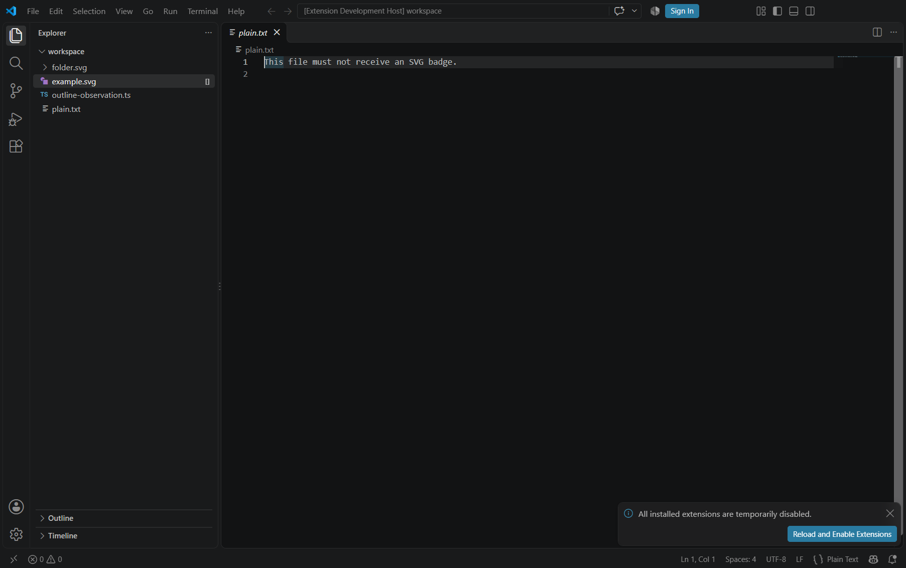

# P2-1a：SVG 文件标记与原生大纲观察

日期：2026-11-17。前置提交：`e5ae494`（P2-0）。开始时工作区干净。状态：本地验收通过，待用户审阅提交。

后续更新：已由用户提交为 5a5bcbf；下文保留本阶段交付记录。

## 实现与调用关系

`extension.activate` 创建 `SvgFileDecorationProvider`，通过 `window.registerFileDecorationProvider` 注册给 VSCode。VSCode 在 Explorer 渲染资源时回调 `provideFileDecoration`；该类委托纯逻辑 `SvgBadgePolicy`，通过 workspace.fs.stat 判断真实文件类型，返回 badge `[]`、tooltip 和 propagate=false。

不读取/写入 SVG 内容，不改名。非 SVG 路径不执行 stat；目录、文件读取失败和取消均返回空结果。扩展名大小写均支持。FileSystemWatcher 监听创建/修改/删除并触发装饰失效通知；重命名覆盖旧/新 URI。生命周期逆序注销注册项、监听和事件资源，释放后的请求返回空结果。

修改集中于扩展包及其测试/说明、scripts/test-extension.mjs、阶段文档与证据。CLI 业务源码与依赖锁文件没有变化，也未增加 npm 依赖。

## 原生 Outline 的先行观察

在编写文件标记实现前，先启动隔离宿主，观察内置 TypeScript 大纲：Flow 类包含 start 方法，finish 为根级函数，按源码位置排列；点击 finish 后编辑器定位至第 7 行；将其改名为 complete 后大纲更新。初次观察截图见 [实现前截图](../../doc/evidence/phase2/p2-1a-outline-before-implementation.png)。

最终再次验证折叠隐藏 start、展开恢复 start、点击定位和编辑更新，观察结果见 [JSON](../../doc/evidence/phase2/p2-1a-outline-observation.json)、[定位截图](../../doc/evidence/phase2/p2-1a-outline-navigation.png)、[更新截图](../../doc/evidence/phase2/p2-1a-outline-update.png)。测试修改发生在临时副本内并还原。

这确认了原生 Outline 由提供者给出层级和范围、宿主完成展开和导航的工作方式。它是内置 TypeScript 提供者的行为证据，不宣称 SVG 大纲已经实现。下一阶段将提供 DocumentSymbolProvider；本阶段未注册自定义大纲或自建 TreeView。

## 文件标记证据

截图来自真实 Extension Development Host 的 Electron 窗口，CDP 仅用于测试点击、读取渲染样式和截图；未模拟 UI，也未修改截图。example.svg 行尾有 []，普通 plain.txt、TypeScript 文件及 folder.svg 目录没有；打开的是 plain.txt，尚未打开 SVG 文本。

[标记验证 JSON](../../doc/evidence/phase2/p2-1a-badge-checks.json) 包含前后文件名/内容 SHA-256、目录排除、取消/释放、五类刷新结果和真实渲染的 [] 样式。[宿主版本](../../doc/evidence/phase2/p2-1a-host.json) 为 VSCode 1.143.1 / Node 24.21.0 / Electron 43.7.7。

## 实际验证

| 命令/场景 | 结果 |
|---|---|
| npm.cmd run build:extension | 严格类型检查和 bundle 通过 |
| npm.cmd run test:extension:unit | 4 项通过：生命周期、大小写/Unicode 路径、排除/故障、取消 |
| npm.cmd run test:extension | 真实自动激活、Explorer 标记、目录排除、刷新、取消/释放、文件名/内容不变；退出码 0 |
| SVG_OBSERVE_OUTLINE=1 的宿主测试 | 内置 Outline 层级、折叠/展开、点击定位、编辑更新；退出码 0 |
| npm.cmd run build | CLI 编译通过 |
| npm.cmd test -- test/integration/cli.acceptance.test.ts | 4 项既有综合验收通过 |
| git diff --check | 通过 |

fixture 在每次启动时复制到唯一临时工作区；创建、编辑、重命名、删除测试不操作仓库中的源 fixture。完整调试数据留在忽略的 .tmp/phase2，正式证据保存到 doc/evidence/phase2。没有以全套 214 项重复运行替代有针对性的本阶段检查。

## AI 建议核验与修正

- 先用真实类型判断文件，避免仅后缀判断而给 folder.svg 目录加标记；实际截图/宿主测试验证这一点。
- UI 检查最初假设旧版 Explorer CSS 容器存在；真实截图显示功能正确，DOM 诊断确认选择器过时，修正为实际行节点和伪元素样式，保留真实徽标断言。
- Windows watcher URI 的盘符大小写与 workspace URI 可能不同。测试按 Windows 路径规则比较，生产仍向宿主传原 URI；未跳过刷新断言。
- 只监听并发送刷新事件，不缓存目录内容；取消、文件删除竞争、释放后的异步结果均返回空装饰。
- CDP 测试辅助采用类型化协议返回值，无新增浏览器包；仅隔离测试宿主使用随机调试端口。

## 复现与下一步

从仓库根执行 build:extension、test:extension:unit、test:extension。人工查看可按 F5 启动 “SVG extension development host”，无需先打开 SVG 即可见标记；原生观察的环境变量步骤见 [扩展说明](../../extensions/vscode-svg/README.md)。文件装饰需要 VSCode Explorer Badges 设置启用。

本阶段未执行 git commit/push/tag。建议提交：`feat(vscode): decorate SVG files in Explorer`。下一阶段 P2-1b 实现 SVG 大纲、源码范围/导航、异常 XML 更新与扩展打包。
